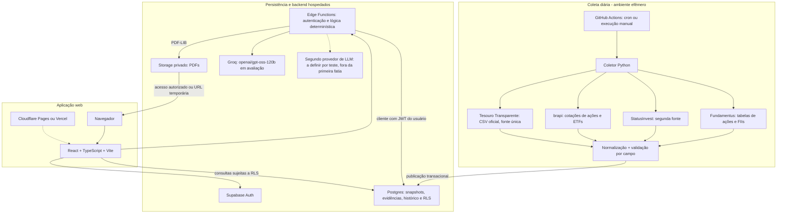
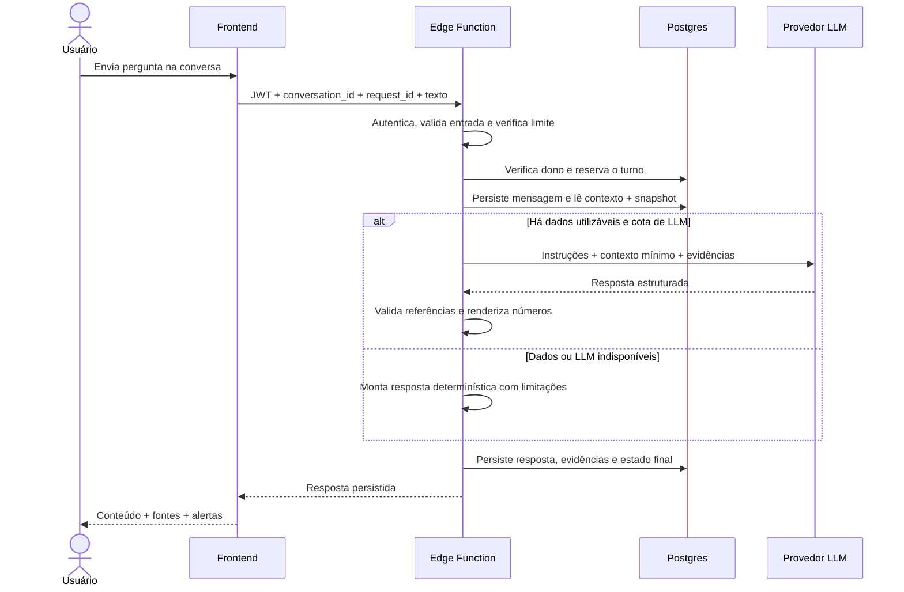

# Agente de Investimentos


[](#licenca)


**Pesquisa de investimentos com rastreabilidade, validação por campo e conversas persistentes.**

Projeto pessoal de **Guilherme**, estudante de **Gestão da Informação na Universidade Federal de Goiás — UFG**, com experiência em dados, inteligência artificial, RAG, NLP e aprendizado de máquina.

O Agente de Investimentos propõe reunir informações de ações, fundos imobiliários, ETFs e Tesouro Direto em uma aplicação web própria. A experiência combina consultas em linguagem natural, comparação de múltiplos ativos e relatórios em PDF, sempre preservando a origem dos dados e tornando divergências visíveis.

> **Princípio central:** nenhum dado numérico de investimento deve ser apresentado sem fonte. Concordância em um indicador não valida os demais indicadores de uma fonte.

> **Estado desta documentação:** especificação técnica e operacional da arquitetura proposta. Não foi disponibilizado código para comprovar funcionalidades existentes. Por isso, os recursos estão marcados como **planejados**, **condicionados** ou **backlog**. A árvore de arquivos, os scripts, os contratos e as migrations abaixo são o padrão de implementação a adotar; comandos próprios do projeto só funcionarão depois que esses componentes existirem. Os exemplos não representam testes executados nem dados reais de mercado.

**Referência de verificação externa:** 21 de setembro de 2026. Planos gratuitos, modelos e APIs podem mudar; os links oficiais estão reunidos em [Referências](#referencias).

---

## Sumário

- [1. Visão geral e motivação](#visao-geral)
- [2. Decisões, premissas e bloqueios conhecidos](#decisoes)
- [3. Escopo funcional e estado de implementação](#escopo)
- [4. Arquitetura](#arquitetura)
- [5. Stack tecnológica](#stack)
- [6. Fontes, cobertura e atualização diária](#fontes)
- [7. Normalização, cross-validation e proveniência](#validacao)
- [8. Persistência, autenticação e isolamento](#persistencia)
- [9. Agente, contexto e fallback de LLM](#agente)
- [10. Relatórios multiativo e PDF](#relatorios)
- [11. Estrutura proposta do repositório](#estrutura)
- [12. Configuração e variáveis de ambiente](#configuracao)
- [13. Setup local para desenvolvimento](#setup)
- [14. Coleta manual e agendamento](#coleta)
- [15. Contratos de API e exemplos de uso](#api)
- [16. Deploy e entrada de usuários de teste](#deploy)
- [17. Limites gratuitos e controle de consumo](#limites)
- [18. Segurança, privacidade e uso das fontes](#seguranca)
- [19. Testes e critérios de aceite](#testes)
- [20. Operação e solução de problemas](#operacao)
- [21. Roadmap](#roadmap)
- [22. Contribuição](#contribuicao)
- [23. Aviso legal](#aviso-legal)
- [24. Licença e autoria](#licenca)
- [25. Referências](#referencias)

---

<a id="visao-geral"></a>
## 1. Visão geral e motivação

Pesquisar investimentos exige navegar entre fontes que podem usar datas-base, fórmulas, janelas e critérios de atualização distintos. Um indicador aparentemente idêntico pode não representar a mesma medição.

Este projeto busca reduzir o trabalho de reunir essas informações **sem esconder a incerteza dos dados**. O agente funciona como uma interface de consulta sobre uma base coletada e validada previamente, não como uma fonte autônoma de fatos financeiros.

### Experiência pretendida

O usuário entra na aplicação, inicia ou retoma uma conversa e solicita, por exemplo:

```text
Compare PETR4 e VALE3 usando P/VP, P/L, dividend yield e ROE.
Mostre as fontes e destaque os indicadores divergentes.

Monte um relatório de HGLG11 e KNRI11.
Informe quais indicadores não puderam ser verificados.

Liste os títulos do Tesouro disponíveis na base e explique
a diferença entre taxa prefixada e taxa indexada.
```

As respostas devem indicar a data-base, a situação de atualização, a cobertura efetiva e as referências de cada dado. O usuário também pode gerar um PDF e acessá-lo novamente sem refazer o relatório.

### O que o agente não é

Não é uma plataforma de negociação, um terminal de cotações em tempo real, um gestor de carteira nem um mecanismo de recomendação personalizada. A v1 não exige conexão com corretoras, saldo, posição de custódia ou credenciais bancárias.

A futura experiência inspirada em NotebookLM corresponde a **respostas apoiadas em documentos identificáveis**, com página e trecho de origem. Não existe integração com NotebookLM nem pipeline de RIs implementado na v1.

---

<a id="decisoes"></a>
## 2. Decisões, premissas e bloqueios conhecidos

### 2.1 Código aberto não significa infraestrutura integralmente aberta

A intenção é usar código e bibliotecas de código aberto e operar dentro de cotas gratuitas. Entretanto, **a combinação de serviços proposta não constitui uma stack integralmente open source**: a operação depende de serviços gerenciados de terceiros e de modelos acessados por API.

A formulação operacional adotada para o desenho é:

> **Aplicação com intenção de licenciamento aberto, dependências abertas e execução hospedada dentro de planos gratuitos, quando a cobertura contratada permitir.**

Se “100% open source” for uma restrição literal também para modelos e infraestrutura, será necessária uma decisão de arquitetura diferente. Este README não apresenta os serviços gerenciados como se fossem autohospedagem gratuita, nem promete capacidade ilimitada.

### 2.2 Ajustes em relação ao desenho inicial

| Tema | Constatação ou limitação | Tratamento e decisão |
| --- | --- | --- |
| Fonte do Tesouro | A dependência do plano Pro da brapi foi descartada. | **Decidido:** construir adaptador próprio para o CSV oficial do Tesouro Transparente, fonte primária e única, sem cross-check entre fontes para Tesouro. |
| Modelo primário na Groq | O modelo inicialmente previsto, `llama-3.3-70b-versatile`, foi descontinuado para os planos Free e Developer em **16/08/2026**, conforme a referência desta documentação. | **Candidato definido:** usar `openai/gpt-oss-120b`, configurado em `GROQ_MODEL`. A adoção definitiva permanece sujeita aos testes de qualidade. |
| Limites dos modelos | “30 requisições/minuto” e “1 milhão de tokens/dia” não são garantias gerais. | Consultar cotas por modelo, projeto e organização; controlar requisições e tokens. |
| Indicadores de FIIs | A presença de campos no Fundamentus não comprova disponibilidade equivalente no StatusInvest. | **Decidido:** FFO yield, cap rate e vacância permanecem na v1; sem campo equivalente homologado no StatusInvest, a observação utilizável fica `single_source`, sem bloquear a entrega do campo nem forçar `verified`. |
| PDF em Edge Functions | A execução definida usa o runtime Deno das Edge Functions. | **Decidido:** manter `pdf-lib` nativo em Deno, sem mini-backend Python. Testes de consumo e paginação continuam necessários, mas a escolha do renderizador não está pendente. |
| Login no beta | O método de autenticação da fase de beta foi confirmado. | **Decidido:** Google OAuth via Supabase Auth como método único. E-mail/senha e outros métodos não são alternativas de login no beta hospedado. |
| Ordem de entrega | O escopo completo da v1 não foi medido nem construído. | **Decidido** em [`docs/adr/0001-primeira-fatia-acoes.md`](docs/adr/0001-primeira-fatia-acoes.md): a entrega começa por uma fatia vertical só de ações, de ponta a ponta. Onde o ADR e este README divergem, vale o ADR. |

Fontes: [CSV oficial do Tesouro Transparente][tesouro-csv], [descontinuações da Groq][groq-deprecations], [cotas da Groq][groq-limits], [cotas do Gemini][gemini-limits], [limites das Edge Functions][supabase-edge-limits], [PDF-LIB][pdf-lib] e [login Google no Supabase][supabase-google].

As decisões de arquitetura e escopo não comprovam implementação. Os recursos continuam planejados até cumprir os respectivos critérios de aceite; o modelo Groq ainda precisa concluir a avaliação de qualidade.

### 2.3 Decisão definida: Tesouro via CSV oficial

**Decidido:** construir um adaptador próprio para o [CSV oficial de preços e taxas do Tesouro Transparente][tesouro-csv]. O Tesouro Transparente é a **fonte primária e única** dos dados de Tesouro Direto. A brapi não participa da aquisição nem da validação dessa classe, e não há dependência de seu plano Pro.

O adaptador `treasury_official.py` deverá integrar o coletor Python e mapear títulos, datas, preços, taxas e metadados para os contratos do projeto. A lista de títulos e o histórico publicados devem refletir a cobertura efetiva do arquivo oficial, homologada antes da liberação.

**Cross-check:** não é exigido para Tesouro. Uma observação utilizável proveniente do CSV é apresentada como `single_source`, com identificação da fonte oficial e aviso de que não houve verificação entre fontes. Isso não dispensa normalização, validação de contrato, proveniência e controle de atualização, nem autoriza atribuir `verified`.

**Estado inicial recomendado:** Tesouro previsto como habilitado desde a v1, com `treasury.enabled: true` e `treasury.mode: official_csv`. A disponibilidade efetiva depende da implementação e homologação do novo adaptador e da publicação de um snapshot utilizável; a decisão de fonte não está mais pendente. Não há modo brapi sandbox no desenho adotado.

---

<a id="escopo"></a>
## 3. Escopo funcional e estado de implementação

**Legenda:** planejado = requisito ainda não comprovado; condicionado = depende de cobertura, permissão ou decisão; backlog = fora da primeira versão.

| Funcionalidade | Versão | Estado | Critério de conclusão |
| --- | --- | --- | --- |
| Login multiusuário | v1 | Planejado | Usuário único na primeira fatia (ADR 0001, D7). Google OAuth como login único no beta; usuário autenticado e autorizado acessa somente seus dados. |
| Conversas e mensagens persistentes | v1 | Planejado | Recarregar, sair e entrar novamente não apaga o histórico. |
| Cotação de ações via brapi | v1 | Planejado | Dado armazenado no lote diário com fonte e data de mercado. |
| Cotações de ETFs | v1 | Planejado | Cotação via brapi no lote diário, com fonte, data-base e estado de validação, sob os mesmos critérios de qualidade dos demais ativos. |
| P/VP, DY, P/L e ROE de ações | v1 | Planejado | Extração e comparação individual com segunda fonte equivalente. |
| DY e P/VP de FIIs | v1 | Planejado | Mesmos critérios de proveniência e comparação. |
| FFO yield, cap rate e vacância de FIIs | v1 | Planejado | Cobertura e metodologia registradas campo a campo; sem equivalente homologado no StatusInvest, publicar observação utilizável como `single_source`, sem bloquear o campo nem atribuir `verified`. |
| Lista, taxas e histórico de Tesouro | v1 | Planejado | Adaptador próprio do CSV oficial implementado e homologado, cobertura explícita e proveniência por campo; sem exigência de cross-check. |
| Coleta global diária | v1 | Planejado | Um workflow atualiza o universo configurado, sem coleta no chat. |
| Alertas de divergência na interface | v1 | Planejado | Valores, fontes, diferença e tolerância exibidos. |
| URL de consulta manual por ativo | v1 | Planejado | Link válido de referência, separado das evidências dos indicadores. |
| Relatório multiativo | v1 | Planejado | Um snapshot consistente, com limitações e fontes. |
| PDF persistido e reutilizável | v1 | Planejado | Arquivo privado armazenado e disponível sem regeneração. |
| Histórico de indicadores fundamentalistas | Futuro | Backlog | Não confundir com histórico de taxas/preços do Tesouro. |
| Download, indexação e resumo de RIs | Futuro | Backlog | Respostas com documento, página, trecho e versão. |
| Alertas proativos por e-mail ou push | Futuro | Backlog | Não confundir com avisos apresentados em uma consulta. |
| Orquestração com LangGraph | Futuro | Backlog | Adotar apenas quando o fluxo justificar estados e ramificações. |

**Cobertura não significa todos os ativos da B3.** A primeira entrega deve publicar o universo efetivamente homologado, os indicadores cobertos e as restrições por classe.

---

<a id="arquitetura"></a>
## 4. Arquitetura

### 4.1 Visão por camadas



### 4.2 Separação de responsabilidades

**Coleta:** acessa fontes externas, extrai registros, normaliza valores, valida contratos, executa comparação quando aplicável e publica um snapshot. Não recebe perguntas de usuários, não chama LLM e não gera PDFs.

**Persistência:** guarda dados de mercado compartilhados, evidências, resultados de validação e dados privados por conta. O snapshot persistido é o cache remoto oficial da aplicação.

**Backend:** autentica, verifica propriedade da conversa, controla cotas, consulta o snapshot, prepara evidências, chama o modelo quando necessário e persiste o resultado.

**Frontend:** apresenta conversas, fontes, alertas e relatórios. Nunca faz scraping nem recebe chaves privadas de fornecedores.

### 4.3 Caminho de uma pergunta



Não há processo de coleta permanentemente ligado. A aplicação publicada continua acessível sem que a máquina do desenvolvedor esteja em execução. O backend e a persistência dependem da disponibilidade dos serviços hospedados.

---

<a id="stack"></a>
## 5. Stack tecnológica

As escolhas abaixo definem uma implementação de referência, não uma lista de componentes já instalados.

| Camada | Tecnologia | Uso proposto |
| --- | --- | --- |
| Coleta | [Python](https://www.python.org/) | Adaptadores de fontes, normalização e processamento batch. |
| HTTP | [HTTPX](https://www.python-httpx.org/) | Timeouts, sessões e chamadas HTTP controladas. |
| HTML | [Beautiful Soup](https://www.crummy.com/software/BeautifulSoup/bs4/doc/) | Extração de tabelas; seletores testados por fixtures. |
| Contratos Python | [Pydantic](https://docs.pydantic.dev/) | Validação de configuração e observações extraídas. |
| Precisão | [decimal](https://docs.python.org/3/library/decimal.html) | Cálculo decimal de diferenças e indicadores derivados. |
| Agendamento | [GitHub Actions][github-schedule] | Execução diária e manual em runner hospedado. |
| Banco | [PostgreSQL](https://www.postgresql.org/) no [Supabase](https://supabase.com/docs) | Dados de mercado, conversas, mensagens e metadados. |
| Identidade | [Supabase Auth](https://supabase.com/docs/guides/auth) | Google OAuth como login único do beta e identidade da conta. |
| Autorização | [RLS][supabase-rls] | Isolamento no banco, além das verificações do backend. |
| Arquivos | [Supabase Storage][supabase-storage] | PDFs privados e evidências quando permitido. |
| Sincronização | [Supabase Realtime](https://supabase.com/docs/guides/realtime) | Opcional: atualização da interface; não substitui persistência. |
| Backend | [Supabase Edge Functions][supabase-edge-auth] | Endpoints em TypeScript e execução sob demanda. |
| Runtime | [Deno](https://deno.com/) | Runtime da implementação TypeScript das funções. |
| LLM primário | [Groq](https://console.groq.com/docs) | `openai/gpt-oss-120b` como candidato definido, configurado por ambiente e ainda em avaliação de qualidade. |
| LLM alternativo | A definir | O segundo provedor será escolhido por teste. A primeira fatia não tem fallback de LLM (ADR 0001, D6). O Gemini é apenas um candidato a avaliar, não o fallback definido. |
| Frontend | [React](https://react.dev/), [TypeScript](https://www.typescriptlang.org/), [Vite](https://vite.dev/) | Aplicação própria e build estático. |
| SDK | [supabase-js](https://supabase.com/docs/reference/javascript/introduction) | Auth, banco, Storage e chamadas às funções. |
| Contratos TypeScript | [Zod](https://zod.dev/) | Validação de entrada e de respostas dos modelos. |
| PDF | [PDF-LIB][pdf-lib] | Escolha decidida: geração nativa no runtime Deno das Edge Functions, a partir de modelo estruturado. |
| Hospedagem principal | [Cloudflare Pages][cloudflare-limits] | Distribuição do frontend estático. |
| Hospedagem alternativa | [Vercel Hobby][vercel-hobby] | Alternativa para uso pessoal não comercial. |
| Testes | [pytest](https://docs.pytest.org/), [Vitest](https://vitest.dev/), [Playwright](https://playwright.dev/), [pgTAP](https://pgtap.org/) | Testes de coletores, frontend, jornadas e políticas SQL. |

**Não previstos na v1:** LangChain, LangGraph, CrewAI, Redis, banco vetorial, worker permanente, Kubernetes e servidor Python dedicado à API.

**PDF — decisão fechada:** manter `pdf-lib`, executado nativamente no runtime Deno das Edge Functions. A alternativa de mini-backend Python foi descartada; WeasyPrint e ReportLab não compõem essa solução. Python permanece restrito à coleta. Os testes de carga e paginação continuam necessários para ajustar o template e os limites do relatório, não para reabrir a escolha da biblioteca. [Referência][pdf-lib].

---

<a id="fontes"></a>
## 6. Fontes, cobertura e atualização diária

### 6.1 Matriz de aquisição e verificação

| Classe/campo | Aquisição preferencial | Corroboração planejada | Restrição |
| --- | --- | --- | --- |
| Ações: cotação | brapi | Cotação equivalente em Fundamentus e/ou StatusInvest | Mesma sessão, moeda e instante de referência compatível. |
| Ações: P/VP, DY, P/L, ROE | Fundamentus | StatusInvest | Mesma fórmula, janela e tratamento contábil. |
| FIIs: DY e P/VP | Fundamentus | StatusInvest | Não misturar DY mensal, anualizado e acumulado. |
| FIIs: FFO yield e cap rate | Fundamentus | StatusInvest, quando houver campo equivalente homologado | Sem equivalente homologado, observação utilizável em `single_source`; não bloqueia a entrega do campo nem autoriza `verified`. |
| FIIs: vacância | Fundamentus | StatusInvest, quando houver medida agregada equivalente homologada | Sem equivalente homologado, observação utilizável em `single_source`; vacância física, financeira e média por imóvel não são intercambiáveis. |
| Tesouro: títulos, taxas e histórico | CSV oficial do Tesouro Transparente, via adaptador próprio | Não exigida: fonte primária e única | Disponível na v1 após implementar e homologar o adaptador; observações utilizáveis em `single_source`, com cobertura explícita. |
| ETFs: cotação | brapi | Segunda cotação comparável, se disponível | Escopo funcional da v1, com os mesmos critérios de proveniência e validação por campo; não aplicar automaticamente o conjunto de indicadores de ações. |

As [tabelas de ações][fundamentus-stocks] e de [FIIs do Fundamentus][fundamentus-fiis] são os pontos de entrada previstos. A tabela de FIIs expõe rótulos como FFO Yield, Cap Rate e Vacância Média. A [página de referência do StatusInvest][statusinvest-fii] deve ser inspecionada por campo; a presença de informações por imóvel, por exemplo, não comprova equivalência com uma média agregada.

### 6.2 Cotações via brapi e Tesouro via CSV oficial

Para uma integração nova de cotações de ações e ETFs, adotar o contrato v2 e manter eventual suporte ao legado apenas dentro do adaptador:

```text
GET https://brapi.dev/api/v2/stocks/quote?symbols=PETR4
```

Os parâmetros aceitos e os nomes dos campos devem seguir o contrato oficial de [cotações][brapi-quote]. A brapi é usada para cotações, não para aquisição de Tesouro.

Para Tesouro, usar exclusivamente o [CSV oficial de preços e taxas do Tesouro Transparente][tesouro-csv], processado por `treasury_official.py`. Não implementar chamadas às rotas de Tesouro da brapi nem utilizar seu sandbox como fallback.

O adaptador deve homologar o formato do arquivo e mapear seus registros para o cadastro de títulos, as observações e o histórico. Preservar tipo de título, indexador, vencimento, modalidade de cupom, lado de compra ou venda, taxa, preço, unidade e data-base, conforme a informação disponível e o mapeamento homologado. Metadados ausentes não devem ser inventados.

Um spread sobre Selic não deve ser renderizado como se fosse uma taxa prefixada nominal. A interpretação da taxa deve permanecer explícita no contrato normalizado. Conforme a decisão específica de Tesouro, não há exigência de cross-check entre fontes; as validações de contrato e proveniência continuam obrigatórias.

### 6.3 O significado de “uma coleta por dia”

A unidade de atualização é **o universo configurado**, não a pergunta do usuário.

```text
Lote diário
  -> enumera o universo homologado
  -> coleta cada fonte
  -> normaliza as observações
  -> valida cada campo e compara fontes quando aplicável
  -> publica um snapshot
  -> todas as consultas usam esse snapshot
```

Algumas fontes podem exigir uma requisição HTTP por ativo. Isso não cria um job nem um TTL por ticker: são chamadas internas do mesmo lote diário. No plano Free da brapi consultado, o limite anunciado é de um ativo por requisição. [Referência][brapi-pricing].

A v1 não implementa:

```text
Pergunta do usuário -> scraping ao vivo -> resposta
```

Adicionar um ativo à interface não dispara coleta imediata. Um ativo fora do universo fica identificado como **não coberto**, até inclusão e processamento em um lote posterior.

### 6.4 Cache e atualização

O Postgres é a fonte persistida de consulta. Arquivos locais em `.cache/` servem somente a desenvolvimento ou processamento temporário; o filesystem do runner não é o banco da aplicação.

Cada publicação contém `snapshot_id`, `run_id`, `collected_at`, datas-base por observação e versão dos parsers. A data de coleta não substitui a data do dado.

**Política proposta:**

- Atualização diária, com idade máxima de referência configurável.
- Se uma coleta falhar, manter o último snapshot publicado e exibir sua idade real.
- Não substituir valores anteriores por zeros, tabelas vazias ou datas artificialmente atuais.
- Distinguir `fresh`, `stale`, `expired` e `unknown_reference_date`.
- Após expiração configurada, não descrever o dado como atual; oferecer consulta histórica explícita ou indicar indisponibilidade.
- Considerar calendário de negociação e atraso normal da fonte antes de concluir que há falha.

A publicação deve ocorrer em transação: carregar em staging, validar integridade e trocar o ponteiro do snapshot ativo. Um lote parcialmente coletado só pode ser publicado com manifesto de cobertura explícito; nunca como “base completa atualizada”.

---

<a id="validacao"></a>
## 7. Normalização, cross-validation e proveniência

### 7.1 Contrato mínimo de uma observação

Uma observação representa **um campo de um ativo em uma fonte**, não um objeto inteiro certificado.

| Campo | Significado |
| --- | --- |
| `observation_id` | Identificador imutável da evidência. |
| `asset_id`, `asset_class` | Identificação canônica do ativo e de sua classe. |
| `metric` | Indicador canônico, como `price_to_book` ou `dividend_yield`. |
| `raw_value` | Texto ou valor recebido, antes da normalização. |
| `value_decimal` | Decimal normalizado, serializado como string no JSON. |
| `unit`, `currency` | Unidade e moeda, quando aplicáveis. |
| `period_start`, `period_end` | Janela econômica representada, quando conhecida. |
| `reference_at` | Instante ou data-base informada pela fonte. |
| `collected_at` | Momento em que a aplicação coletou o dado. |
| `source_id`, `source_url` | Provedor e URL de evidência sem credenciais. |
| `upstream_source` | Origem primária conhecida, sem inventar independência. |
| `methodology_id` | Fórmula e convenções do campo; `unknown` quando ausentes. |
| `run_id`, `parser_version` | Linhagem operacional. |
| `raw_content_hash` | Hash do conteúdo utilizado; não substitui a evidência. |

O backend deve rejeitar números não finitos e unidades incompatíveis. URLs registradas não podem conter tokens, identificadores de sessão ou parâmetros secretos.

### 7.2 Regras de normalização

`1.234,56` pode representar `1234.56` em uma página brasileira, mas o parser deve conhecer o formato daquela fonte, não aplicar substituições cegas a qualquer texto.

Para percentuais, adotar uma convenção única:

```text
Valor normalizado: "8.50"
Unidade: percent
Exibição: 8,50%
Diferença absoluta entre percentuais: pontos percentuais
```

Não misturar `0.085` e `8.5` como se estivessem na mesma escala.

Ausência, “N/A”, traço, erro de parsing e indicador não aplicável são estados distintos. Um zero pode ser um valor legítimo ou um marcador da fonte; somente o contrato daquele campo autoriza classificá-lo como ausência.

Identificar ativos com metadados de classe e, quando necessário, CNPJ/ISIN ou identificador do provedor. Não inferir a classe apenas pelo sufixo do ticker, pois o cadastro canônico deve prevalecer.

### 7.3 Comparabilidade antes de tolerância

A comparação exige identidade do ativo, unidade, fórmula, janela e data-base compatíveis.

```text
Mesmo ativo?
  -> Mesmo conceito e unidade?
     -> Mesma janela/metodologia?
        -> Datas comparáveis?
           -> Aplicar tolerância numérica
```

Se a fonte não informar elementos suficientes para demonstrar comparabilidade, registrar `incomparable` ou `unknown_metadata`. **Não atribuir `verified` porque os números parecem próximos.**

Exemplos de combinações que precisam ser recusadas:

| Combinação | Motivo |
| --- | --- |
| DY dos últimos doze meses versus último dividendo anualizado | Janelas e fórmulas diferentes. |
| Vacância física versus vacância financeira | Conceitos diferentes. |
| Cap rate versus dividend yield | Indicadores diferentes. |
| Preço intradiário versus fechamento de outro dia | Datas/instantes incompatíveis. |
| Taxa de compra versus taxa de venda de Tesouro | Lados diferentes da operação. |
| ROE com patrimônio médio versus patrimônio final | Metodologia potencialmente diferente. |

Essas são regras de comparação propostas; a homologação de cada adaptador deve registrar como reconhece as diferenças.

### 7.4 Fórmula de tolerância

Para dois valores comparáveis `a` e `b`:

```text
delta_abs = abs(a - b)
limite = max(atol, rtol * max(abs(a), abs(b)))

Se delta_abs <= limite: verified
Se delta_abs > limite: divergent
```

`atol` é a tolerância absoluta na unidade do campo. `rtol` é a tolerância relativa em fração decimal. Para percentuais armazenados na escala de 0 a 100, `atol` é medido em **pontos percentuais**.

Configuração inicial **ilustrativa, não calibrada nem recomendação financeira**:

```yaml
# config/tolerances.yaml
version: "draft-1"
comparison: "max_absolute_or_relative"

metrics:
  quote_price:
    unit: BRL
    atol: "0.05"
    rtol: "0.005"
  price_to_book:
    unit: ratio
    atol: "0.02"
    rtol: "0.02"
  price_to_earnings:
    unit: ratio
    atol: "0.10"
    rtol: "0.03"
  dividend_yield:
    unit: percent
    atol: "0.20"
    rtol: "0"
  roe:
    unit: percent
    atol: "0.50"
    rtol: "0"
  ffo_yield:
    unit: percent
    atol: "0.30"
    rtol: "0"
  cap_rate:
    unit: percent
    atol: "0.30"
    rtol: "0"
  vacancy:
    unit: percent
    atol: "0.50"
    rtol: "0"
  treasury_buy_rate:
    unit: percent_per_year
    atol: "0.02"
    rtol: "0"
  treasury_buy_price:
    unit: BRL
    atol: "0.10"
    rtol: "0.001"
```

A configuração de tolerâncias não resolve comparabilidade. Alterações devem ser versionadas e justificadas; aumentar a tolerância apenas para eliminar alertas é um defeito de governança.

Exemplo de função para valores cuja comparabilidade **já foi verificada**:

```python
from decimal import Decimal

def within_tolerance(
    a: Decimal,
    b: Decimal,
    *,
    atol: Decimal,
    rtol: Decimal,
) -> bool:
    values = (a, b, atol, rtol)
    if not all(value.is_finite() for value in values):
        raise ValueError("Todos os valores devem ser decimais finitos.")
    if atol < 0 or rtol < 0:
        raise ValueError("Tolerâncias não podem ser negativas.")

    limit = max(atol, rtol * max(abs(a), abs(b)))
    return abs(a - b) <= limit

assert within_tolerance(
    Decimal("1.00"),
    Decimal("1.01"),
    atol=Decimal("0.02"),
    rtol=Decimal("0.02"),
)
assert not within_tolerance(
    Decimal("8.50"),
    Decimal("9.10"),
    atol=Decimal("0.20"),
    rtol=Decimal("0"),
)
```

### 7.5 Estados de validação

| Estado | Condição | Apresentação |
| --- | --- | --- |
| `verified` | Duas ou mais observações comparáveis concordam na tolerância | Valor de apresentação e todas as referências da comparação. |
| `divergent` | Observações comparáveis excedem a tolerância | Valores lado a lado, diferença, limite e fontes. |
| `single_source` | Apenas uma observação utilizável | Fonte única e aviso de não verificado. |
| `incomparable` | Há observações, mas a comparação não é defensável | Exibir diferenças de janela, conceito ou data. |
| `missing` | Nenhuma observação utilizável | “Não disponível”; nunca zero inventado. |
| `not_applicable` | Indicador não se aplica àquele ativo | Motivo explícito, sem participar do denominador de cobertura aplicável. |
| `invalid` | Falha de contrato ou parsing | Dado não entra na tabela principal; erro fica registrado. |

A condição de atualização é independente: um campo pode estar `verified` entre fontes e, ainda assim, `stale`.

**Fonte única não cumpre cross-validation.** A aplicação pode mostrar esse dado como `single_source`, com a fonte e o aviso de não verificado entre fontes, mas não tratá-lo como `verified` nem usá-lo silenciosamente em conclusões.

**Critérios de entrega definidos para a v1:** FFO yield, cap rate e vacância de FIIs podem cumprir o requisito funcional com uma observação utilizável do Fundamentus em `single_source` quando não houver campo equivalente homologado no StatusInvest. Tesouro também pode cumprir seu requisito funcional em `single_source`, pois o CSV oficial do Tesouro Transparente foi definido como fonte primária e única, sem exigência de cross-check. Em ambos os casos, a aceitação funcional não significa que houve validação entre fontes.

Para os três indicadores de FIIs, um campo do StatusInvest que não seja equivalente homologado não entra como segunda observação utilizável da mesma métrica; a ausência de equivalência deve ficar registrada. Se existir um campo equivalente homologado, mas as observações não forem comparáveis por janela, metodologia ou data, aplicar `incomparable`; não ocultar a incompatibilidade com `single_source`.

Essas decisões não dispensam evidência, atualização, normalização e validação de contrato. Não converter ausência ou erro em `single_source`: sem observação utilizável, manter `missing` ou `invalid`, conforme o caso. Para os demais requisitos que exigem comparação, fonte única continua sem cumprir o critério de cross-validation.

Com três fontes, armazenar os resultados par a par. Concordância entre duas não autoriza ocultar a terceira; o campo mantém o alerta de conflito quando existir uma comparação válida divergente.

### 7.6 Escolha de valor de apresentação

Quando não houver divergência, uma prioridade de exibição pode escolher a observação mostrada em destaque. Essa prioridade é uma convenção de interface, **não uma certificação da fonte inteira**. As demais observações continuam acessíveis.

Quando houver divergência:

- Não calcular média para produzir um “valor correto”.
- Não escolher silenciosamente o menor, o maior ou o da fonte preferida.
- Não usar a concordância do P/VP para validar o DY.
- Não pedir ao LLM que decida qual fonte “está certa”.
- Exibir os dados e a limitação; a conclusão pode ser “não foi possível consolidar este campo”.

### 7.7 Exemplo de evidência divergente

Os valores e as URLs a seguir são **sintéticos**, destinados exclusivamente a testes:

```json
{
  "asset_id": "DEMO3",
  "metric": "dividend_yield",
  "unit": "percent",
  "status": "divergent",
  "freshness": "fresh",
  "selected_value": null,
  "observations": [
    {
      "observation_id": "obs-a",
      "source_id": "fonte-a",
      "value_decimal": "8.50",
      "source_url": "https://example.com/fonte-a/demo3",
      "reference_at": "2026-09-18",
      "methodology_id": "dy_ttm_fixture"
    },
    {
      "observation_id": "obs-b",
      "source_id": "fonte-b",
      "value_decimal": "9.10",
      "source_url": "https://example.com/fonte-b/demo3",
      "reference_at": "2026-09-18",
      "methodology_id": "dy_ttm_fixture"
    }
  ],
  "comparison": {
    "observation_ids": ["obs-a", "obs-b"],
    "absolute_difference": "0.60",
    "difference_unit": "percentage_points",
    "allowed_difference": "0.20",
    "tolerance_version": "draft-1"
  }
}
```

Representação esperada:

```text
DY de DEMO3: divergência identificada.
Fonte A: 8,50% [obs-a]. Fonte B: 9,10% [obs-b].
Diferença: 0,60 ponto percentual, calculada a partir de [obs-a] e [obs-b].
Limite configurado: 0,20 ponto percentual — política draft-1.
Não foi selecionado um valor único.
```

Números derivados, como diferenças, médias autorizadas ou contagens de cobertura, devem informar os registros de entrada e a fórmula. Valores de configuração devem ser identificados como política do sistema, não como dado de mercado.

### 7.8 Link manual versus fonte de evidência

A interface deve devolver uma URL conhecida de consulta manual, por exemplo:

- [PETR4 no StatusInvest](https://statusinvest.com.br/acoes/petr4).
- [HGLG11 no StatusInvest](https://statusinvest.com.br/fundos-imobiliarios/hglg11).

O backend constrói o link a partir do cadastro validado de classe e símbolo. O LLM não inventa URLs.

O link geral é útil para consulta histórica, mas **não substitui a referência de cada observação**. Uma página dinâmica pode mudar após a coleta; por isso, relatórios preservam data-base, valores utilizados e identificação das evidências.

<a id="persistencia"></a>
## 8. Persistência, autenticação e isolamento

### 8.1 Modelo de dados proposto

| Tabela/recurso | Responsabilidade | Regra de acesso |
| --- | --- | --- |
| `auth.users` | Identidade gerenciada pelo Supabase Auth | Não criar tabela pública de senhas. |
| `beta_users` | Usuários autorizados a usar a fase de testes | Usuário lê seu estado; somente administração altera. |
| `conversations` | Dono, título, criação e atualização da conversa | CRUD do próprio dono autorizado. |
| `messages` | Conteúdo, papel, ordem, estado e evidências de cada mensagem | Leitura do dono; gravação pelo backend confiável. |
| `assets` | Identidade, classe e links de referência dos ativos | Leitura autorizada; escrita pela ingestão. |
| `data_sources` | Catálogo de provedores, URLs e permissões homologadas | Sem segredos; manutenção administrativa. |
| `collection_runs` | Resultado operacional de cada lote | Detalhes administrativos; resumo sanitizado ao usuário. |
| `snapshots` | Versões publicadas do conjunto de dados | Leitura autorizada; conteúdo imutável após publicação. |
| `observations` | Valores originais e normalizados por fonte/campo | Leitura autorizada; escrita pela ingestão. |
| `field_validations` | Comparações, tolerâncias, estados e motivos | Leitura autorizada; sem alteração pelo navegador. |
| `active_snapshot` | Ponteiro para a publicação ativa por universo | Alteração transacional pela ingestão. |
| `relatorios_pdf` | Dono, parâmetros, conteúdo congelado, hash, caminho e estado do PDF | Leitura do dono; geração/exclusão pelo backend. |
| `request_runs` | Idempotência e estado de processamento das solicitações | Somente a solicitação do próprio usuário pode ser consultada. |
| `usage_counters` | Limites por usuário e provedor | Sem manipulação pelo cliente. |
| Storage `reports` | Arquivos PDF | Bucket privado com autorização por proprietário. |

Índices mínimos: conversas por `(user_id, updated_at, id)`, mensagens por `(conversation_id, sequence_no)`, observações por `(snapshot_id, asset_id, metric, source_id)` e relatórios por `(user_id, created_at)`.

Usar UUIDs para identificação, `timestamptz` para eventos e `numeric` para valores financeiros. O JSON transporta decimais como strings; cálculos de validação ficam em Python/SQL decimal, não em ponto flutuante do navegador.

### 8.2 Invariantes de integridade

Uma mensagem pertence a uma conversa e ao mesmo usuário. Isso deve ser reforçado no banco, não apenas na interface:

```sql
-- Contrato a incorporar às migrations completas.
alter table public.conversations
  add constraint conversations_id_owner_unique unique (id, user_id);

alter table public.messages
  add constraint messages_conversation_owner_fk
  foreign key (conversation_id, user_id)
  references public.conversations (id, user_id)
  on delete cascade;
```

Aplicar o mesmo princípio a relatórios vinculados a conversas.

Também são necessários:

```text
unique (conversation_id, sequence_no)
unique (user_id, request_id) em request_runs
unique (user_id, input_hash) em relatorios_pdf
unique (snapshot_id, asset_id, metric, source_id) para observações atuais
```

Se uma fonte fornecer múltiplos períodos para o mesmo indicador, a chave de observação deve incluir o período ou a série. Não aplicar a última restrição indiscriminadamente ao histórico de Tesouro.

### 8.3 RLS é obrigatório, mas não substitui grants

Habilitar RLS em todas as tabelas de aplicação expostas. Definir privilégios SQL mínimos e políticas por operação. Views expostas também precisam respeitar o isolamento; em versões compatíveis, usar `security_invoker = true`. [Referência][supabase-rls].

Exemplo de políticas para tabelas **já criadas** pelas migrations:

```sql
alter table public.beta_users enable row level security;
alter table public.conversations enable row level security;

revoke all on public.beta_users from anon, authenticated;
grant select on public.beta_users to authenticated;

create policy beta_users_read_self
on public.beta_users for select to authenticated
using (user_id = (select auth.uid()));

-- SECURITY INVOKER: a consulta a beta_users continua sujeita a RLS.
create function public.is_beta_user()
returns boolean
language sql
stable
security invoker
set search_path = ''
as $$
  select exists (
    select 1
    from public.beta_users b
    where b.user_id = (select auth.uid()) and b.enabled
  );
$$;

revoke all on function public.is_beta_user() from public;
grant execute on function public.is_beta_user() to authenticated;

revoke all on public.conversations from anon, authenticated;
grant select, delete on public.conversations to authenticated;
grant insert (user_id, title) on public.conversations to authenticated;
grant update (title) on public.conversations to authenticated;

create policy conversations_read_own
on public.conversations for select to authenticated
using (
  user_id = (select auth.uid())
  and (select public.is_beta_user())
);

create policy conversations_insert_own
on public.conversations for insert to authenticated
with check (
  user_id = (select auth.uid())
  and (select public.is_beta_user())
);

create policy conversations_update_own
on public.conversations for update to authenticated
using (
  user_id = (select auth.uid())
  and (select public.is_beta_user())
)
with check (
  user_id = (select auth.uid())
  and (select public.is_beta_user())
);

create policy conversations_delete_own
on public.conversations for delete to authenticated
using (
  user_id = (select auth.uid())
  and (select public.is_beta_user())
);
```

Este exemplo **não é a migration completa**. É necessário implementar e testar políticas equivalentes para as demais tabelas, índices, triggers de data, limites de conteúdo e grants administrativos.

`messages` e `relatorios_pdf` não devem aceitar escrita arbitrária pelo cliente. O usuário não pode inserir uma mensagem com `role = 'assistant'`, fabricar fontes ou marcar um PDF como concluído.

### 8.4 Clientes de banco nas Edge Functions

Manter uma separação explícita:

| Cliente | Uso |
| --- | --- |
| Cliente com JWT do usuário | Leitura sujeita a RLS e operações que o usuário pode executar diretamente. |
| Cliente administrativo | Escritas de sistema estritamente necessárias, depois de autenticação, autorização e validação de propriedade. |

Chaves secretas e `service_role` podem contornar RLS. Portanto, usar uma chave administrativa no backend **não transfere automaticamente as políticas do usuário para a consulta**. O `user_id` deve vir da identidade autenticada, nunca do corpo da requisição. [Referências][supabase-edge-auth] e [segredos][supabase-secrets].

RPCs administrativas de publicação e finalização devem ter execução revogada de `public`, `anon` e `authenticated`, quando forem exclusivas do serviço. Funções `security definer` exigem escopo mínimo, `search_path` controlado e revisão específica.

### 8.5 Persistência e continuidade de conversa

O banco, e não `localStorage`, é a fonte de verdade do histórico.

Ao abrir uma conversa, o frontend carrega mensagens paginadas e ordenadas. Ao enviar uma mensagem, o backend reserva um turno, persiste o pedido e conclui a resposta com identificador estável.

A interface pode usar atualizações otimistas, mas deve reconciliá-las com os registros persistidos. Realtime é opcional; uma consulta normal deve reconstruir o estado após recarregamento.

O histórico visual pode ser completo e paginado enquanto o contexto enviado ao LLM é limitado. **Persistir uma conversa não significa reenviar todas as mensagens em toda chamada.**

### 8.6 Retenção e exclusão

Política proposta para o beta:

- Conversas e mensagens permanecem até exclusão pelo usuário ou encerramento comunicado do teste.
- Não apagar histórico silenciosamente para liberar espaço; ao se aproximar da cota, limitar novas gravações e oferecer exportação/exclusão.
- Conservar snapshots operacionais por janela configurável, inicialmente trinta dias, sem prometer séries fundamentalistas ao usuário.
- Mensagens e relatórios guardam um pacote de evidências dos valores apresentados, para que a limpeza de snapshots não quebre referências.
- PDFs ficam armazenados até exclusão explícita ou aplicação de política de retenção informada.
- Excluir uma conta requer também remover objetos do Storage; cascata SQL não apaga automaticamente os arquivos.
- Não aplicar `on delete cascade` da conversa ao registro do PDF sem uma estratégia anterior de limpeza dos objetos.

A rotina de manutenção deve detectar objetos órfãos, relatórios incompletos e referências quebradas, sem remover arquivos ainda acessíveis ao usuário.

---

<a id="agente"></a>
## 9. Agente, contexto e fallback de LLM

### 9.1 Orquestração determinística

A v1 usa funções explícitas:

```text
authenticate
  -> authorize_beta_user
  -> validate_request
  -> reserve_idempotent_turn
  -> load_owned_conversation
  -> resolve_assets
  -> load_published_snapshot
  -> assemble_evidence_bundle
  -> call_primary_model_if_needed
  -> optionally_call_fallback
  -> validate_generated_structure
  -> render_supported_facts
  -> persist_response
```

Na primeira fatia (ADR 0001, D4), o LLM só classifica a intenção da pergunta e devolve um JSON fechado, validado por schema. Ele não redige explicações, não fornece números nem URLs, não coleta valores, não decide tolerâncias e não modifica a base de mercado. As respostas são tabelas e textos determinísticos. A redação de explicações por LLM fica para depois da primeira fatia.

Se o JSON for inválido, a cota acabar ou o provedor falhar, a interface oferece um **seletor manual** de tickers e indicadores (D5), de modo que a consulta nunca fique bloqueada por cota.

Para perguntas simples ou indisponibilidade de modelo, a aplicação pode responder com tabelas e textos determinísticos. O usuário deve ver que o modo explicativo por IA não foi utilizado.

### 9.2 Modelos configuráveis

**Candidato primário definido:** usar `openai/gpt-oss-120b` na Groq, em substituição ao `llama-3.3-70b-versatile` previsto no desenho original e registrado como descontinuado nesta documentação. O modelo antigo não deve permanecer como default nem como fallback implícito.

Definir `GROQ_MODEL=openai/gpt-oss-120b`. O segundo provedor, quando houver, será escolhido por teste; a primeira fatia não tem fallback de LLM (ADR 0001, D6). A escolha do candidato está fechada, mas a **adoção definitiva ainda depende dos testes de qualidade em português, estrutura de saída, latência e consumo**. A disponibilidade e as cotas efetivas devem ser verificadas antes do deploy. [Referências][groq-deprecations] e [cotas][groq-limits].

O Gemini não é o fallback presumido (ADR 0001, D6). Se for avaliado como candidato a segundo provedor, escolher um modelo textual disponível no projeto e na faixa gratuita, sem assumir que versões com o mesmo nome têm as mesmas cotas. [Preços][gemini-pricing] e [limites][gemini-limits].

A implantação deve falhar de forma clara se o modelo configurado não existir ou não puder ser usado. Não migrar automaticamente para modelo pago.

### 9.3 Política de fallback

**Primeira fatia:** não há fallback de LLM (ADR 0001, D6). Quando o provedor primário falha, a interface oferece o seletor manual (D5). A tabela abaixo descreve a política para quando um segundo provedor, escolhido por teste, for adotado.

| Situação | Comportamento |
| --- | --- |
| Timeout, erro transitório ou `429` do primário | Retry limitado, respeitando `Retry-After` e o orçamento total. |
| Primário indisponível após tentativas permitidas | Na primeira fatia, oferecer o seletor manual. Depois dela, usar o segundo provedor somente se habilitado e autorizado para aquele contexto. |
| Credencial inválida ou modelo removido | Registrar erro de configuração; não insistir indefinidamente. |
| Recusa de segurança | Não usar outro provedor para contornar a recusa. |
| Quota dos provedores esgotada | Retornar dados e fontes em modo determinístico. |
| Estrutura produzida não passa na validação | Rejeitar o conteúdo; utilizar resposta segura, sem fatos inventados. |
| Contexto contém informação não permitida no fallback | Não enviar esse conteúdo ao provedor alternativo. |

Reservar no máximo **três chamadas de modelo por requisição**, incluindo decisões de ferramenta, retry e fallback. Esse é um limite inicial da aplicação, não uma cota dos fornecedores.

Não manter uma transação SQL aberta durante uma chamada de LLM. Reservar a operação em transação curta, executar a chamada e finalizar em outra transação.

### 9.4 Tool calling

Tool calling nativo pode ser usado quando necessário, com um catálogo fechado:

```text
get_cached_asset_metrics(asset_ids, metrics)
list_cached_treasury_bonds(filters)
get_cached_treasury_history(bond_id, start_date, end_date)
get_asset_reference_links(asset_ids)
```

Os argumentos passam por schema e autorização. As ferramentas leem exclusivamente o cache publicado. Não existe ferramenta de SQL livre, execução de código, acesso a URL arbitrária ou scraping acionado pelo usuário.

Limitar rodadas de ferramentas e impedir que o modelo altere a identidade do usuário ou selecione uma conversa de outra conta.

### 9.5 Contexto persistente sem crescimento ilimitado

Carregar as mensagens recentes necessárias, uma síntese contextual versionada e o conjunto de evidências da pergunta atual. Uma síntese não substitui os registros originais nem pode ser usada como fonte de indicadores.

Guardar:

```text
conversation_id
summary_text
summary_until_sequence
summary_version
selected_asset_ids
last_report_id
```

Antes da chamada, reservar espaço para instruções, evidências e saída. Se exceder o orçamento, reduzir contexto histórico ou o número de ativos do pedido — nunca remover as referências essenciais para caber no prompt.

### 9.6 Proteção contra números inventados

A resposta do modelo deve ser estruturada. Fatos quantitativos precisam apontar para IDs existentes no pacote de evidências:

```json
{
  "sections": [
    {
      "kind": "metric_comparison",
      "metric": "price_to_book",
      "evidence_ids": ["evidence-petr4-pvp", "evidence-vale3-pvp"]
    },
    {
      "kind": "limitation",
      "validation_ids": ["validation-dy-divergent"]
    }
  ]
}
```

O backend resolve valores, formatação e links. O modelo não fornece números substitutos ou URLs novas.

Texto livre com afirmações quantitativas não sustentadas deve ser rejeitado ou substituído por templates. Uma expressão regular para procurar algarismos, isoladamente, não é uma garantia suficiente: números por extenso e comparações qualitativas também podem insinuar fatos não comprovados.

O critério de aceite é verificável: todos os valores exibidos no chat e no PDF devem apontar para observações ou cálculos determinísticos reproduzíveis.

---

<a id="relatorios"></a>
## 10. Relatórios multiativo e PDF

### 10.1 Conteúdo do relatório

Um relatório deve conter identificação, data de geração, universo solicitado, snapshot utilizado, tabelas por classe de ativo, explicações, campos divergentes, campos indisponíveis, fontes e aviso legal.

Não comparar na mesma coluna indicadores que não se aplicam àquela classe. Um ETF não recebe P/L ou ROE de empresa por conveniência de layout.

**Orçamento inicial proposto:** até dez ativos por relatório e quinze páginas. Os valores são limites de produto sujeitos a benchmark, não garantias de capacidade da Edge Function.

### 10.2 Geração e reutilização

```text
Pedido autenticado
  -> valida proprietário, ativos e tamanho
  -> resolve snapshot e calcula input_hash
  -> procura relatório equivalente do mesmo usuário
       -> pronto: reutiliza registro e arquivo
       -> em geração: informa o estado, sem duplicar trabalho
       -> inexistente: reserva registro
  -> constrói modelo imutável de relatório
  -> gera PDF
  -> envia ao bucket privado
  -> confirma metadados e status ready
  -> retorna referência de download
```

O `input_hash` deve considerar o usuário, os ativos normalizados, campos, snapshot, idioma e versões relevantes de template, validação e prompt. O `content_hash` do arquivo é calculado separadamente após a geração.

Reabrir um relatório já pronto não chama fontes, LLM ou renderizador. Solicitar uma atualização após novo snapshot produz outro relatório; não altera o PDF antigo.

### 10.3 Compatibilidade do renderizador

**Renderizador decidido:** `pdf-lib`, executado nativamente no runtime Deno das Edge Functions, sem mini-backend Python. A biblioteca não transforma automaticamente HTML/CSS em um documento paginado: a aplicação precisa implementar quebra de linhas, paginação, tabelas e referências. [Documentação][pdf-lib].

Usar texto selecionável, fontes com licença compatível, acentuação testada e links identificáveis. Evitar emojis e glifos sem suporte na fonte escolhida. O PDF não deve ser uma captura de tela da interface.

Testar o template no ambiente hospedado: as Edge Functions possuem limites de memória, tempo total e CPU. Se a geração ultrapassar o orçamento, reduzir o tamanho autorizado do relatório ou bloquear essa combinação com mensagem clara. Um renderizador no navegador é alternativa futura, não motivo para aceitar PDFs arbitrários como documentos oficiais do backend. [Limites][supabase-edge-limits].

### 10.4 Armazenamento privado

Estrutura proposta:

```text
reports/
  <user_id>/
    <report_id>/
      report.pdf
```

O bucket não é público. O caminho deve ser gerado pelo servidor e associado a uma linha de `relatorios_pdf` pertencente ao usuário.

A autorização de leitura precisa conferir proprietário, bucket e estado do relatório. Escrita e exclusão ficam com endpoints autenticados, não com upload irrestrito do navegador. Implementar as políticas em `storage.objects` conforme a [documentação de acesso ao Storage][supabase-storage].

URLs assinadas devem ter validade curta — inicialmente cinco minutos. Não armazenar a URL temporária como identidade permanente do arquivo; guardar `storage_path` e emitir novo link após verificar acesso.

Quem possuir uma URL assinada válida poderá utilizá-la durante sua validade. Ela não deve aparecer em logs públicos ou ser enviada a outro usuário.

### 10.5 Falhas e concorrência

Estados propostos: `generating`, `ready`, `failed`, `deleting` e `deleted`.

Se o upload funcionar e a gravação de metadados falhar, a manutenção remove o objeto órfão. Se a função for interrompida, o registro não permanece indefinidamente como se estivesse trabalhando: um prazo de expiração da reserva permite marcar falha e oferecer nova tentativa.

A v1 não presume um worker de PDF continuando após o encerramento da função. A execução deve caber na solicitação ou retornar um estado final de erro; um futuro processamento assíncrono exige infraestrutura e fila explicitamente projetadas.

---

<a id="estrutura"></a>
## 11. Estrutura proposta do repositório

```text
agente-investimentos/
|-- README.md
|-- LICENSE.example                  # MIT proposta; confirmar antes de publicar LICENSE
|-- CONTRIBUTING.md                  # A criar
|-- SECURITY.md                      # A criar com canal privado válido
|-- .gitignore
|-- .nvmrc                           # Versão de Node adotada pelo projeto
|-- .python-version                  # Versão de Python adotada pelo projeto
|-- .env.collector.example
|-- package.json                     # CLI Supabase e ferramentas de repositório
|-- package-lock.json
|-- playwright.config.ts             # Configuração dos testes ponta a ponta
|-- pyproject.toml                   # Pacote Python em collector/src
|-- requirements.lock                # Dependências runtime fixadas, com hashes
|-- requirements-dev.lock            # Dependências de testes fixadas, com hashes
|
|-- config/
|   |-- universe.yaml
|   |-- sources.yaml                 # Permissões, cobertura e estratégia por fonte
|   |-- tolerances.yaml
|   `-- retention.yaml
|
|-- collector/
|   |-- src/collector/
|   |   |-- __init__.py
|   |   |-- cli.py
|   |   |-- settings.py
|   |   |-- sources/
|   |   |   |-- base.py
|   |   |   |-- fundamentus.py
|   |   |   |-- statusinvest.py
|   |   |   |-- brapi.py
|   |   |   `-- treasury_official.py  # Adaptador próprio do CSV oficial; previsto na v1
|   |   |-- normalization/
|   |   |-- validation/
|   |   |-- persistence/
|   |   `-- pipeline.py
|   `-- tests/
|       |-- fixtures/
|       |-- unit/
|       `-- integration/
|
|-- frontend/
|   |-- .env.example
|   |-- package.json
|   |-- package-lock.json
|   |-- public/
|   |   |-- _redirects               # Fallback de rotas para hospedagem estática
|   |   `-- _headers                 # Cabeçalhos de segurança
|   |-- src/
|   |   |-- components/
|   |   |-- features/
|   |   |   |-- auth/
|   |   |   |-- conversations/
|   |   |   |-- assets/
|   |   |   `-- reports/
|   |   |-- lib/supabase.ts
|   |   |-- routes/
|   |   `-- main.tsx
|   `-- tests/
|
|-- supabase/
|   |-- config.toml
|   |-- .env.functions.example
|   |-- migrations/
|   |   |-- 202609210001_core.sql
|   |   |-- 202609210002_market_data.sql
|   |   |-- 202609210003_rls.sql
|   |   |-- 202609210004_storage.sql
|   |   `-- 202609210005_ingestion_and_limits.sql
|   |-- seed.sql                     # Somente dados sintéticos de desenvolvimento
|   |-- tests/database/
|   `-- functions/
|       |-- deno.json
|       |-- deno.lock
|       |-- _shared/
|       |   |-- auth.ts
|       |   |-- config.ts
|       |   |-- schemas.ts
|       |   |-- evidence.ts
|       |   |-- rate-limit.ts
|       |   |-- llm/
|       |   |   |-- groq.ts
|       |   |   |-- gemini.ts
|       |   |   `-- router.ts
|       |   `-- pdf/
|       |-- agent/index.ts
|       |-- reports/index.ts
|       |-- assets/index.ts
|       |-- operations/index.ts
|       `-- tests/
|
|-- schemas/
|   |-- observation.schema.json
|   |-- validation.schema.json
|   `-- report.schema.json
|
|-- docs/
|   |-- architecture/
|   |-- adr/                         # Registros de decisões arquiteturais
|   |-- source-methodologies/
|   |-- data-dictionary.md
|   `-- runbooks/
|
|-- tests/e2e/
`-- .github/
    |-- workflows/
    |   |-- collect-daily.yml
    |   `-- ci.yml
    |-- ISSUE_TEMPLATE/
    `-- pull_request_template.md
```

Os arquivos de `schemas/` são o contrato entre Python, backend e frontend. Mudanças incompatíveis exigem versão e teste de contrato. Segredos, PDFs reais, dados pessoais e dumps não pertencem ao repositório.

---

<a id="configuracao"></a>
## 12. Configuração e variáveis de ambiente

### 12.1 Separação dos ambientes

| Ambiente | Dados | Credenciais |
| --- | --- | --- |
| Local | Fixtures e contas fictícias | Chaves do Supabase local; LLM simulado por padrão de desenvolvimento. |
| Testes hospedados | Universo pequeno e usuários autorizados | Projeto Supabase de teste e chaves específicas. |
| Produção futura | Dados e usuários reais | Segredos independentes e política operacional revisada. |

Não conectar testes destrutivos ao banco hospedado. O coletor e o backend devem rejeitar combinações inconsistentes entre ambiente, destino e modo de fixtures.

### 12.2 Coletor: `.env.collector`

Criar a partir de `.env.collector.example`. Campos intencionalmente vazios:

```dotenv
APP_ENV=
SUPABASE_URL=
COLLECTOR_DATABASE_URL=
BRAPI_TOKEN=
SCRAPER_CONTACT=
```

| Variável | Uso |
| --- | --- |
| `APP_ENV` | Ambiente validado: desenvolvimento, testes hospedados ou produção. |
| `SUPABASE_URL` | Endpoint do projeto correspondente ao ambiente. |
| `COLLECTOR_DATABASE_URL` | Conexão com o papel de banco dedicado do coletor, que só pode executar a RPC de publicação (ADR 0001, D13). Nunca enviada ao frontend. |
| `BRAPI_TOKEN` | Autenticação da brapi para cotações de ações e ETFs; não é utilizado pelo adaptador de Tesouro. |
| `SCRAPER_CONTACT` | Contato técnico usado na identificação do coletor, quando aplicável. |

A credencial do coletor é um **papel de banco dedicado**, com permissão exclusiva de executar a RPC de publicação e sem acesso a conversas (ADR 0001, D13). A chave `service_role` do Supabase ignora RLS e não é usada pelo coletor nem entra nos secrets do GitHub. Não confundir esse papel com a chave pública `anon`.

### 12.3 Edge Functions: `supabase/.env.functions`

```dotenv
APP_ENV=
APP_ORIGINS=
GROQ_API_KEY=
GROQ_MODEL=openai/gpt-oss-120b
MOCK_LLM=
# Segundo provedor de LLM: a definir por teste; fora da primeira fatia (ADR 0001, D6).
```

| Variável | Uso |
| --- | --- |
| `APP_ORIGINS` | Origens permitidas, separadas por vírgula; correspondência exata. |
| `GROQ_API_KEY`, `GROQ_MODEL` | Credencial e modelo primário; candidato definido: `openai/gpt-oss-120b`, ainda sujeito à avaliação de qualidade. |
| `MOCK_LLM` | Respostas simuladas somente em desenvolvimento/testes locais. |

As variáveis de infraestrutura Supabase são disponibilizadas pelo runtime. Não incluir variáveis reservadas com prefixo `SUPABASE_` no arquivo enviado por `supabase secrets set`; seguir o contrato de [segredos do ambiente][supabase-secrets] e os [limites de nomes reservados][supabase-edge-limits].

O backend deve impedir `MOCK_LLM` no ambiente publicado de uso real. A primeira fatia não tem fallback de LLM, então não há credencial de segundo provedor.

### 12.4 Frontend: `frontend/.env.local`

```dotenv
VITE_SUPABASE_URL=
VITE_SUPABASE_PUBLISHABLE_KEY=
VITE_APP_URL=
```

São valores públicos de configuração. Uma chave pública do Supabase não é uma chave de LLM nem uma credencial administrativa.

**Tudo com prefixo `VITE_` pode ser incorporado ao bundle do navegador.** Nunca criar `VITE_GROQ_API_KEY`, `VITE_GEMINI_API_KEY`, `VITE_BRAPI_TOKEN` ou `VITE_SUPABASE_SERVICE_ROLE_KEY`. [Referência][vite-env].

### 12.5 Credenciais de administração e autenticação

| Local | Configuração |
| --- | --- |
| Terminal/CI de deploy | `SUPABASE_ACCESS_TOKEN`, `SUPABASE_PROJECT_REF` e, quando exigido pela operação, `SUPABASE_DB_PASSWORD`. |
| GitHub Actions de coleta | Segredos `SUPABASE_URL`, `SUPABASE_SECRET_KEY`, `BRAPI_TOKEN`; variável `SCRAPER_CONTACT`. |
| Supabase Auth | Client ID e Client Secret do Google OAuth, único provedor de login do beta, configurados no painel de Auth. |
| Hospedagem do frontend | Somente as variáveis públicas `VITE_*`. |

Não enviar credenciais de deploy ao coletor se ele não as utiliza. Não fornecer chaves de LLM ao workflow de scraping.

### 12.6 Configuração de produto

Valores iniciais **propostos**, a implementar em configuração versionada e validar no backend:

| Parâmetro | Valor inicial | Objetivo |
| --- | --- | --- |
| Ativos por relatório | 10 | Limitar contexto e renderização. |
| Páginas por PDF | 15 | Controlar consumo e legibilidade. |
| Chamadas LLM por solicitação | 3, contando retries e fallback | Evitar ciclos e estouro de cota. |
| Tamanho da mensagem | 8.000 caracteres | Reduzir abuso e contexto excessivo. |
| Conversas simultaneamente processadas por usuário | 1 | Simplificar ordem e limitar consumo. |
| Referência inicial de cache vencido (`stale`) | Mais de 1 dia útil | Aviso; ajustar por calendário e fonte (ADR 0001, D20). |
| Idade máxima para apresentar como informação utilizável (`expired` acima disso) | 5 dias úteis | Após isso, somente histórico explicitamente identificado (ADR 0001, D20). |
| Validade da URL assinada | 5 minutos | Reduzir exposição do arquivo privado. |
| Retenção operacional de snapshots | 30 dias | Limitar armazenamento, preservando evidências já utilizadas. |
| Modo exclusivamente gratuito | Ativado | Nunca contratar ou habilitar consumo pago automaticamente. |

O prazo de cache não define a atualidade de um balanço contábil: idade da coleta, período econômico e atraso da fonte são dimensões diferentes.

Exemplo de universo inicial:

```yaml
# config/universe.yaml
version: "beta-1"
stocks:
  - PETR4
  - VALE3
fiis:
  - HGLG11
  - KNRI11
etfs: []  # Preencher com ETFs homologados antes de liberar a v1.
treasury:
  enabled: true
  mode: official_csv
```

Os símbolos são exemplos de configuração, não uma recomendação de investimento.

A lista vazia de `etfs` é apenas um placeholder de cadastro: os ETFs fazem parte do escopo funcional da v1 e o universo homologado deve ser preenchido antes da liberação. Não foi definida nesta revisão uma lista de tickers de ETFs.

O modo `official_csv` é o contrato de configuração proposto para selecionar o adaptador do Tesouro Transparente. `enabled: true` registra a decisão de incluir Tesouro na v1; não comprova que o adaptador esteja implementado ou que já exista um snapshot utilizável.

### 12.7 `.gitignore` mínimo

```gitignore
**/.env*
!**/.env.example
!**/.env.*.example

.venv/
**/__pycache__/
.pytest_cache/
.cache/
node_modules/
**/node_modules/
frontend/dist/
supabase/.temp/
supabase/.branches/

private-data/
exports/
backups/
*.log
```

O bloqueio de segredos não depende só do `.gitignore`: revisar commits e executar detecção de segredos na integração contínua.

<a id="setup"></a>
## 13. Setup local para desenvolvimento

> **Pré-condição:** esta sequência é o contrato de execução da estrutura proposta. `npm ci`, o pacote `collector`, as migrations e as Edge Functions precisam estar implementados e versionados. Se um desses arquivos ainda não existe, a etapa correspondente pertence ao trabalho de construção da v1; não há um executável oculto fornecido por este README.

### 13.1 Pré-requisitos

Adotar inicialmente Python 3.12, Node.js 22 e Deno 2 como versões de referência do projeto, fixando versões efetivamente testadas em arquivos de configuração e lockfiles.

Também são necessários Git, um runtime de containers compatível com Docker para o Supabase local e contas dos serviços que serão usados em integração. Docker Engine ou Rancher Desktop são opções para avaliar conforme o sistema operacional. O Supabase CLI documenta o uso de runtimes compatíveis e sua instalação como dependência de desenvolvimento. [Referência][supabase-cli].

Os comandos abaixo usam shell POSIX. No Windows, usar um ambiente compatível, como WSL, ou adaptar a ativação do ambiente virtual ao PowerShell.

### 13.2 Clonar e instalar

Substituir `SEU_USUARIO` pelo proprietário real do repositório:

```bash
git clone https://github.com/SEU_USUARIO/agente-investimentos.git
cd agente-investimentos

python -m venv .venv
source .venv/bin/activate

python -m pip install --require-hashes -r requirements-dev.lock
python -m pip install --no-deps -e .

npm ci
npm --prefix frontend ci
```

No PowerShell, a ativação equivalente é:

```powershell
.\.venv\Scripts\Activate.ps1
```

O `package.json` raiz deve incluir o Supabase CLI em versão fixada. O `requirements-dev.lock` deve conter o conjunto completo de dependências de desenvolvimento e runtime com hashes; não apontar `--require-hashes` para um arquivo de dependências não travado.

### 13.3 Iniciar o Supabase local

```bash
npx supabase start
npx supabase status
```

Copiar os valores locais apropriados para os arquivos de ambiente. A saída de `status` pode conter credenciais; não publicar essa saída em issues.

Aplicar o esquema de desenvolvimento:

```bash
npx supabase db reset
```

**Atenção:** `db reset` reconstrói o banco local e pode apagar dados de desenvolvimento. Não executar uma operação destrutiva contra um projeto remoto.

As migrations devem criar tabelas, constraints, índices, políticas RLS, RPCs, bucket privado e regras de Storage. `seed.sql` deve conter somente dados sintéticos.

### 13.4 Criar os arquivos de ambiente

```bash
cp .env.collector.example .env.collector
cp supabase/.env.functions.example supabase/.env.functions
cp frontend/.env.example frontend/.env.local
```

Preencher com as credenciais do **mesmo ambiente**.

Para desenvolvimento sem chamadas externas, configurar o modo de LLM simulado e utilizar fixtures. O modo de fixtures deve aceitar apenas destino local explicitamente reconhecido; não carregar dados sintéticos no projeto hospedado.

### 13.5 Criar usuários locais de teste

No painel local do Supabase, criar duas contas fictícias distintas. Habilitar cada uma em `beta_users` com uma operação administrativa, usando os UUIDs realmente gerados:

```sql
-- Substituir o placeholder pelo UUID real do usuário local.
insert into public.beta_users (user_id, enabled)
values ('<UUID_DO_USUARIO_LOCAL>', true)
on conflict (user_id) do update set enabled = excluded.enabled;
```

Repetir para a segunda conta. A aplicação não oferece ao usuário uma operação para autorizar a si próprio.

Exclusivamente para desenvolvimento local, e-mail/senha pode ser usado com o serviço de e-mail de teste do ambiente. Essa facilidade para contas fictícias não é uma alternativa de autenticação no beta hospedado, cujo único método de login é Google OAuth.

### 13.6 Validar configuração e carregar dados sintéticos

Interface proposta do CLI:

```bash
python -m collector.cli doctor \
  --env-file .env.collector \
  --offline

python -m collector.cli run \
  --env-file .env.collector \
  --mode fixtures
```

O modo offline valida arquivos, dependências e configuração sem consultar fornecedores. O modo de fixtures deve gerar observações e comparações reprodutíveis, incluindo divergência, ausência de campo e fonte única.

### 13.7 Iniciar backend e frontend

Em um terminal:

```bash
npx supabase functions serve \
  --env-file supabase/.env.functions
```

Em outro:

```bash
npm --prefix frontend run dev
```

Usar a URL informada pelo Vite e conferir se `VITE_SUPABASE_URL` aponta para o Supabase local.

Manter a verificação de JWT habilitada nas funções de usuário. Não adicionar `--no-verify-jwt` apenas para fazer o exemplo “funcionar”; a função deve autenticar e autorizar corretamente. [Referência][supabase-edge-auth].

### 13.8 Primeiro teste completo

Entrar com a primeira conta, criar uma conversa, consultar um ativo das fixtures, verificar fontes e divergências, gerar um PDF e recarregar a página.

Em seguida, entrar com a segunda conta e confirmar que a conversa e o PDF anteriores não são acessíveis nem pela interface nem por chamada direta às APIs.

Esse fluxo só está concluído quando o histórico vier do banco após o recarregamento e o PDF for recuperado do Storage sem nova geração.

---

<a id="coleta"></a>
## 14. Coleta manual e agendamento

### 14.1 Comandos previstos do coletor

| Comando | Efeito |
| --- | --- |
| `doctor --offline` | Valida configuração sem consultar fontes. |
| `doctor --online` | Executa verificações mínimas de acesso; pode consumir cota. |
| `run --mode fixtures` | Processa dados sintéticos e publica somente no ambiente local. |
| `run --dry-run` | Coleta e valida dados reais, mas não publica no banco. |
| `run` | Executa lote real e publica conforme os critérios de integridade. |
| `run --force` | Reprocessa o dia de forma explícita, gerando nova revisão auditável. |

Todos devem aceitar `--env-file` para desenvolvimento, carregando variáveis sem sobrescrever segredos já definidos no ambiente de execução.

Exemplos:

```bash
# Requer permissão de uso das fontes e credenciais válidas.
python -m collector.cli doctor --env-file .env.collector --online

# Faz chamadas externas, mas não grava o snapshot.
python -m collector.cli run --env-file .env.collector --dry-run

# Publicação real: conferir o projeto de destino antes de executar.
python -m collector.cli run --env-file .env.collector
```

`--dry-run` não significa “sem acesso à internet” nem “sem consumo de quota”.

### 14.2 Workflow diário

A credencial do coletor é a conexão com o papel de banco dedicado `collector_ingest` (`COLLECTOR_DATABASE_URL`), não `SUPABASE_SECRET_KEY` nem `service_role` (ADR 0001, D13).

Exemplo para `.github/workflows/collect-daily.yml`, dependente do CLI proposto:

```yaml
name: Coleta diaria de investimentos

on:
  workflow_dispatch:
    inputs:
      force:
        description: Reprocessar o dia com nova revisao auditavel
        required: false
        default: false
        type: boolean
  schedule:
    # UTC por omissao: 23:17 UTC = 20:17 em UTC-03.
    - cron: "17 23 * * *"

permissions:
  contents: read

concurrency:
  group: coleta-investimentos-${{ github.repository }}
  cancel-in-progress: false

jobs:
  collect:
    runs-on: ubuntu-latest
    timeout-minutes: 20

    steps:
      - name: Checkout
        uses: actions/checkout@v7
        with:
          persist-credentials: false

      - name: Configurar Python
        uses: actions/setup-python@v7
        with:
          python-version: "3.12"
          cache: pip
          cache-dependency-path: requirements.lock

      - name: Instalar dependencias travadas
        run: |
          python -m pip install --require-hashes -r requirements.lock
          python -m pip install --no-deps -e .

      - name: Coletar, validar e publicar
        env:
          APP_ENV: staging
          COLLECTOR_DATABASE_URL: ${{ secrets.COLLECTOR_DATABASE_URL }}
          BRAPI_TOKEN: ${{ secrets.BRAPI_TOKEN }}
          SCRAPER_CONTACT: ${{ vars.SCRAPER_CONTACT }}
          COLLECTOR_FORCE: ${{ inputs.force || 'false' }}
        run: python -m collector.cli run
```

`COLLECTOR_FORCE` é a entrada do workflow equivalente a `--force`; o CLI deve interpretar o booleano explicitamente. O ambiente `staging` representa o beta hospedado e deve apontar para o projeto correspondente.

As versões de Actions acima seguem os exemplos dos repositórios oficiais consultados. Antes de publicar o workflow definitivo, fixar cada Action em um **SHA completo revisado** e manter atualizações controladas. [Checkout][github-checkout] e [setup-python][github-python].

### 14.3 Disparo manual no GitHub

No repositório:

```text
Actions
  -> Coleta diaria de investimentos
  -> Run workflow
```

Opcionalmente, usando GitHub CLI instalado e autenticado:

```bash
gh workflow run collect-daily.yml
gh run list --workflow collect-daily.yml
```

Para reprocessamento intencional:

```bash
gh workflow run collect-daily.yml -f force=true
```

Reexecutar o lote pode consumir novamente a cota das fontes. O botão não deve ser exposto aos usuários finais da aplicação.

### 14.4 Regras do lote

O coletor deve:

1. Validar ambiente, fontes autorizadas, universo e orçamento antes de começar.
2. Definir `run_id`, data lógica do lote em `America/Sao_Paulo` e versão do universo.
3. Evitar nova coleta de um lote já concluído no dia, salvo `--force`.
4. Usar timeout, backoff limitado e redução de concorrência por domínio.
5. Coletar tabelas agregadas uma vez quando disponíveis; evitar downloads duplicados.
6. Registrar falhas por fonte/campo, sem converter falha em zero.
7. Validar estrutura, duplicidades, cobertura e comparabilidade.
8. Publicar de forma atômica e conservar o snapshot anterior em caso de falha.
9. Produzir logs e resumo sanitizados, sem tokens, HTML integral ou dados de contas.

Divergências numéricas são resultados de validação e não precisam invalidar todo o lote. Já um parser que deixou de reconhecer uma tabela ou publicou uma base vazia deve impedir a promoção silenciosa do snapshot.

### 14.5 Limitações do agendamento

O cron proposto usa UTC explicitamente por convenção; a data de referência dos dados continua vindo das fontes.

Workflows agendados executam na branch padrão e podem sofrer atraso ou descarte em períodos de alta carga. Repositórios públicos inativos podem ter agendamentos desabilitados após sessenta dias. Não tratar GitHub Actions como um agendador com garantia de execução pontual. [Agendamento][github-schedule] e [inatividade][github-inactivity].

Não criar commits vazios ou chamadas artificiais apenas para contornar políticas de inatividade de plataformas.

---

<a id="api"></a>
## 15. Contratos de API e exemplos de uso

Os contratos abaixo são propostos. Versionar os schemas no repositório e manter o comportamento compatível entre backend e frontend.

### 15.1 Endpoints

Base:

```text
https://<PROJECT_REF>.supabase.co/functions/v1
```

| Método/rota | Responsabilidade | Autorização |
| --- | --- | --- |
| `POST /agent` | Processar uma mensagem e persistir a resposta | Conta autorizada e dona da conversa. |
| `GET /assets?ids=...` | Consultar indicadores do snapshot | Conta autorizada. |
| `POST /reports` | Criar ou reutilizar relatório e PDF | Conta autorizada; dono definido no servidor. |
| `GET /reports/<id>` | Consultar metadados e estado | Dono do relatório. |
| `POST /reports/<id>/download` | Emitir acesso temporário ao arquivo existente | Dono do relatório. |
| `DELETE /reports/<id>` | Excluir arquivo e metadados de forma controlada | Dono do relatório. |
| `GET /operations` | Diagnóstico operacional sanitizado | Administrador autorizado. |

Conversas podem usar a API de dados do Supabase com RLS. O histórico de mensagens é somente leitura para o cliente; a escrita passa pelo agente.

### 15.2 Criar conversa e enviar mensagem pelo frontend

Exemplo usando um cliente `supabase` já configurado:

```typescript
import { supabase } from "./lib/supabase";

export async function startConversation() {
  const { data: authData, error: authError } = await supabase.auth.getUser();

  if (authError || !authData.user) {
    throw new Error("É necessário entrar na aplicação.");
  }

  const { data: conversation, error: conversationError } = await supabase
    .from("conversations")
    .insert({
      user_id: authData.user.id,
      title: "Comparação de ativos",
    })
    .select("id")
    .single();

  if (conversationError) {
    throw new Error("Não foi possível criar a conversa.");
  }

  const requestId = crypto.randomUUID();

  const { data: response, error: agentError } = await supabase.functions.invoke(
    "agent",
    {
      body: {
        request_id: requestId,
        conversation_id: conversation.id,
        message: "Compare PETR4 e VALE3 e destaque divergências.",
        asset_ids: ["PETR4", "VALE3"],
      },
    },
  );

  if (agentError) {
    // A interface deve permitir consultar o estado antes de reenviar.
    // Em uma repetição da mesma operação, reutilizar requestId.
    throw new Error("A solicitação não pôde ser concluída. Consulte seu estado.");
  }

  return { conversationId: conversation.id, requestId, response };
}
```

O corpo não define `user_id` no endpoint do agente. A identidade vem do JWT. O backend também resolve e valida a relação entre tickers, classes e universo; não confia apenas na lista enviada pelo navegador.

### 15.3 Carregar mensagens persistidas

```typescript
export async function loadMessages(conversationId: string, offset = 0) {
  const pageSize = 50;

  const { data, error } = await supabase
    .from("messages")
    .select("id, sequence_no, role, content, status, citations, created_at")
    .eq("conversation_id", conversationId)
    .order("sequence_no", { ascending: true })
    .range(offset, offset + pageSize - 1);

  if (error) {
    throw new Error("Não foi possível carregar as mensagens.");
  }

  return data;
}
```

RLS é o controle de autorização. Acrescentar um filtro `user_id` no frontend não substitui uma política no banco.

### 15.4 Contrato de resposta do agente

```json
{
  "request_id": "6e51ed30-9fd4-48fd-9a19-060f8197cda1",
  "conversation_id": "2d3c5625-ec42-4621-bc15-f5f3c0be6dd3",
  "message_id": "d0bac106-f32b-46dc-88e9-7ef2be0db985",
  "status": "completed",
  "mode": "deterministic",
  "snapshot_id": "snapshot-example",
  "content": "Exemplo de estrutura; não contém dados reais de mercado.",
  "citations": [],
  "warnings": [
    {
      "code": "LLM_UNAVAILABLE",
      "message": "A resposta foi montada sem geração por IA."
    }
  ],
  "coverage": {
    "status": "partial",
    "missing_metrics": ["cap_rate"]
  }
}
```

Uma resposta real que apresente números de mercado não pode retornar `citations: []`. O exemplo demonstra o envelope, não um relatório de investimento.

### 15.5 Criar relatório via HTTP

As variáveis devem vir do ambiente local de teste. `USER_ACCESS_TOKEN` é o token da sessão do usuário, não uma chave administrativa.

```bash
curl --fail-with-body \
  -X POST "${SUPABASE_URL}/functions/v1/reports" \
  -H "Authorization: Bearer ${USER_ACCESS_TOKEN}" \
  -H "apikey: ${SUPABASE_PUBLISHABLE_KEY}" \
  -H "Content-Type: application/json" \
  --data '{
    "request_id": "8dcbe128-0f4b-479c-b3ba-ac51b34a8c32",
    "asset_ids": ["PETR4", "VALE3"],
    "metrics": ["price_to_book", "price_to_earnings", "dividend_yield", "roe"],
    "locale": "pt-BR",
    "include_explanation": true
  }'
```

Exemplo de retorno:

```json
{
  "report_id": "7d0a8475-c4a6-467d-ae2c-2ab116069990",
  "status": "ready",
  "reused": false,
  "snapshot_id": "snapshot-example",
  "download_endpoint": "/reports/7d0a8475-c4a6-467d-ae2c-2ab116069990/download"
}
```

### 15.6 Erros e idempotência

| HTTP/código | Significado |
| --- | --- |
| `400 INVALID_REQUEST` | Entrada inválida ou parâmetro fora do schema. |
| `401 UNAUTHENTICATED` | Sessão ausente, inválida ou expirada. |
| `403 ACCESS_DENIED` | Conta sem autorização para o beta ou ação proibida. |
| `404 NOT_FOUND` | Recurso inexistente ou não pertencente ao usuário, sem revelar terceiros. |
| `409 REQUEST_CONFLICT` | Mesmo `request_id` com conteúdo diferente ou operação incompatível. |
| `413 REPORT_TOO_LARGE` | Pedido excede limites de tamanho. |
| `422 UNSUPPORTED_ASSET` | Ativo/classe/campo fora do universo suportado. |
| `429 QUOTA_EXCEEDED` | Limite de usuário ou serviço atingido; indicar possibilidade de nova tentativa. |
| `503 DATA_UNAVAILABLE` | Não há snapshot utilizável. |
| `503 REPORT_GENERATION_FAILED` | Arquivo não foi concluído; nenhuma URL pública é retornada. |

Repetir o mesmo `request_id` com o mesmo conteúdo deve retornar a operação existente, sem duplicar mensagem, consumo lógico ou PDF. Com conteúdo diferente, retornar conflito.

Para uma reserva ainda em andamento, retornar `202` com o estado conhecido. Isso não é uma promessa de worker permanente: a UI precisa tratar expiração e falha da execução original.

---

<a id="deploy"></a>
## 16. Deploy e entrada de usuários de teste

### 16.1 Preparar o projeto Supabase

Criar um projeto dedicado ao beta, revisar plano e região, guardar credenciais fora do repositório e confirmar que o banco não contém dados de produção.

Com o CLI instalado:

```bash
npx supabase login
npx supabase link --project-ref "$SUPABASE_PROJECT_REF"

# Revisar as migrations antes de aplicá-las ao projeto remoto.
npx supabase db push
```

A implantação deve interromper em caso de migrations faltantes, divergência de esquema ou testes de RLS reprovados. Não desabilitar políticas para contornar um erro de permissão.

### 16.2 Configurar OAuth

**Decisão confirmada:** Google OAuth via Supabase Auth é o **único método de login do beta hospedado**. E-mail/senha, magic link e outros provedores não são alternativas nesta fase; manter esses métodos desabilitados nesse ambiente.

Configuração:

1. Criar/configurar a aplicação OAuth no provedor, com apenas os escopos de identidade necessários.
2. Cadastrar o callback do Supabase no provedor OAuth.
3. Configurar Client ID e Client Secret no painel de Supabase Auth.
4. Definir Site URL e a allowlist de redirecionamentos da aplicação.
5. Restringir o público de teste conforme a configuração do provedor.
6. Autorizar os usuários aceitos em `beta_users`.

O callback do provedor para o Supabase e a URL de retorno do Supabase para o frontend são endereços diferentes. Em fluxo PKCE, implementar a troca do código por sessão na rota de callback. [Referência][supabase-google].

Não dar aos usuários de teste acesso administrativo ao projeto Supabase apenas para permitir recebimento de e-mails.

A adoção de login por e-mail ou recuperação de senha própria da aplicação fica fora do beta e exigiria uma nova decisão, além de estratégia de SMTP adequada. As limitações do serviço padrão não devem ser contornadas habilitando e-mail/senha como alternativa nesta fase. [Referência][supabase-smtp].

### 16.3 Publicar funções e segredos

```bash
npx supabase secrets set \
  --project-ref "$SUPABASE_PROJECT_REF" \
  --env-file supabase/.env.functions

npx supabase functions deploy agent \
  --project-ref "$SUPABASE_PROJECT_REF"

npx supabase functions deploy reports \
  --project-ref "$SUPABASE_PROJECT_REF"

npx supabase functions deploy assets \
  --project-ref "$SUPABASE_PROJECT_REF"

npx supabase functions deploy operations \
  --project-ref "$SUPABASE_PROJECT_REF"
```

O arquivo de segredos deve conter valores hospedados, não os valores do ambiente local. A verificação de JWT fica habilitada nas funções de usuários, e `operations` exige autorização administrativa adicional.

Confirmar no ambiente hospedado que os modelos configurados estão disponíveis, sem expor nomes de segredos ou respostas brutas em uma rota pública.

### 16.4 Publicar o frontend

Configuração proposta para Cloudflare Pages:

```text
Diretório raiz: frontend
Comando de build: npm run build
Diretório de saída: dist
Variáveis: apenas VITE_SUPABASE_URL, VITE_SUPABASE_PUBLISHABLE_KEY, VITE_APP_URL
```

Para navegação direta em rotas de uma SPA, adicionar em `frontend/public/_redirects`:

```text
/* /index.html 200
```

Configurar cabeçalhos de segurança em `_headers`, usando os domínios reais do projeto. Não aplicar uma CSP genérica sem testar login, chamadas ao Supabase e fontes.

A alternativa Vercel deve usar o mesmo build estático e um fallback equivalente de rotas. O plano Hobby é destinado a uso pessoal não comercial; rever essa escolha antes de monetização ou mudança de finalidade. [Referência][vercel-hobby].

### 16.5 Ativar a coleta

Cadastrar os segredos do workflow, revisar permissões das fontes e executar manualmente um lote. Inspecionar a cobertura publicada antes de habilitar o cron.

Não publicar uma primeira tela vazia como se os dados estivessem atualizados: até existir snapshot utilizável, mostrar estado de preparação ou indisponibilidade.

### 16.6 Verificação de entrada em operação

A liberação do beta requer login externo real exclusivamente com Google OAuth, isolamento entre duas contas, consulta com fontes, recarregamento de histórico, PDF privado reutilizável, tratamento de quota e mensagem de indisponibilidade.

Um frontend online, sozinho, não significa que a aplicação está pronta para usuários.

---

<a id="limites"></a>
## 17. Limites gratuitos e controle de consumo

**Valores consultados em 21/09/2026.** A cota efetiva da conta e os termos do fornecedor prevalecem. Gratuidade é uma meta operacional, não uma garantia permanente.

| Serviço | Referência gratuita consultada | Ação ao se aproximar ou atingir o limite |
| --- | --- | --- |
| Supabase | Banco de 500 MB, Storage de 1 GB, 50 mil MAUs, dois projetos ativos; 5 GB de egress e 5 GB de cached egress, conforme categorias do plano; 500 mil invocações de Edge Functions. | Reduzir retenção técnica autorizada, comprimir PDFs, limitar novos pedidos e monitorar tráfego. Não apagar conversas sem aviso. |
| Supabase inatividade | Projetos gratuitos podem pausar após uma semana de inatividade. | Informar indisponibilidade e restaurar pelo painel; não prometer disponibilidade contínua. |
| Edge Functions | Memória de 256 MB, duração de até 150 segundos no Free e orçamento de CPU de 2 segundos por requisição. | Limitar contexto e PDF, reduzir trabalho de CPU e tratar timeout. |
| GitHub Actions | Runners padrão em repositórios públicos têm uso gratuito; GitHub Free em privados inclui 2.000 minutos mensais e 500 MB de artefatos. | Evitar artefatos grandes, medir duração do lote e interromper novas execuções ao atingir o orçamento. |
| brapi Free | 15.000 requisições mensais e um ativo por chamada, conforme plano consultado. Utilizada para cotações de ações e ETFs; Tesouro usa o CSV oficial e não depende dessa cobertura. | Limitar universo, preservar cache e parar retries quando a cota terminar. |
| Groq | Cotas variam por modelo e organização. A tabela consultada para `openai/gpt-oss-120b` informa 30 RPM, 1.000 RPD, 8.000 TPM e 200.000 TPD. | Aplicar limite global e por usuário, reduzir contexto e usar fallback autorizado ou resposta determinística. |
| Gemini | Cotas dependem do modelo, projeto e faixa; não assumir “1 milhão de tokens/dia”. | Consultar AI Studio, controlar tokens e não habilitar billing automaticamente. |
| Cloudflare Pages | Free com 500 builds mensais, um build simultâneo e limite de 20 mil arquivos por site. | Evitar deploy por alteração de dados; o lote não deve reconstruir o frontend. |
| Vercel Hobby | Uso pessoal não comercial e recursos com limites próprios. | Aguardar reposição conforme o recurso ou revisar hospedagem; não contratar upgrade silencioso. |

Fontes: [Supabase][supabase-pricing], [Edge Functions][supabase-edge-limits], [GitHub Actions][github-billing], [brapi][brapi-pricing], [Groq][groq-limits], [Gemini][gemini-limits], [Cloudflare][cloudflare-limits] e [Vercel][vercel-hobby].

### 17.1 Orçamento de chamadas de dados

Estimativa própria, não dado de fornecedor:

```text
Chamadas mensais aproximadas =
  dias de coleta
  × chamadas por lote
  + retries
  + diagnósticos
  + reprocessamentos manuais
```

Exemplo hipotético: cem ativos, uma chamada de cotação por ativo e trinta e um lotes geram **3.100 chamadas**, antes de retries e demais endpoints. O cálculo não inclui chamadas feitas ao StatusInvest nem determina se o scraping está autorizado.

Usar uma reserva operacional e controlar a janela real de reposição de quota. Não presumir que toda cota mensal é reiniciada no primeiro dia do mês.

### 17.2 Orçamento de LLM

Controlar simultaneamente requisições, tokens de entrada, tokens de saída e uso acumulado. As cotas são compartilhadas entre usuários da mesma aplicação/organização; criar mais contas no frontend não multiplica a cota do provedor.

O limitador deve ser persistente e atômico no banco. Um contador em memória de uma Edge Function não é suficiente para coordenar múltiplas instâncias.

A aplicação deve consultar os headers de quota disponíveis, respeitar `Retry-After` e interromper tentativas que ultrapassem o prazo total de processamento.

### 17.3 Orçamento de armazenamento

Medir:

```text
Banco =
  observações e validações retidas
  + índices
  + conversas e mensagens
  + pacotes de evidência
  + metadados e controle de uso

Storage =
  PDFs mantidos
  + arquivos de evidência cuja retenção esteja autorizada
```

Não baixar HTML integral de todas as fontes e mantê-lo indefinidamente por padrão. Guardar somente o necessário, com permissão e retenção definidas.

Quando não houver espaço, recusar novas gerações de forma clara. Manter o PDF já existente disponível enquanto o serviço permitir; não regenerá-lo a cada acesso.

### 17.4 Política de custo zero

Não anexar automaticamente serviços pagos, ativar billing para contornar limites, criar contas para driblar cotas ou assumir que um alerta de orçamento é um bloqueio financeiro.

Atingir quota deve degradar a funcionalidade, não gerar cobrança inesperada:

```text
IA indisponível -> dados estruturados com fontes
Coleta indisponível -> último snapshot identificado como antigo
Storage cheio -> novos PDFs temporariamente bloqueados
Banco indisponível -> erro explícito, sem fingir que a mensagem foi salva
```

---

<a id="seguranca"></a>
## 18. Segurança, privacidade e uso das fontes

### 18.1 Controles obrigatórios

| Risco | Controle esperado |
| --- | --- |
| Chave de LLM exposta | Segredos apenas em Edge Functions; verificar bundle e logs. |
| Acesso cruzado entre contas | JWT válido, RLS, grants mínimos, FK de proprietário e testes com contas distintas. |
| Abuso de chave administrativa | Uso restrito a processos confiáveis; nunca em browser, PR de fork ou artefato público. |
| Prompt injection em conteúdo externo | Fontes tratadas como dados não confiáveis, sem instruções executáveis. |
| Alucinação numérica | Evidências tipadas e renderização determinística; rejeição de referências inexistentes. |
| SSRF e URLs arbitrárias | Allowlist de hosts; ferramentas não recebem URL livre do usuário. |
| XSS em respostas | Sanitizar Markdown/HTML e aplicar CSP; não renderizar HTML bruto do LLM. |
| Consumo abusivo | Limite persistente por usuário/provedor, tamanho máximo e idempotência. |
| PDF público indevido | Bucket privado, propriedade vinculada ao registro e acesso temporário. |
| Falha de coleta disfarçada | Preservar snapshot anterior e mostrar estado real de atualização. |

CORS limita origens permitidas no navegador, mas não é autenticação nem impede chamadas fora do navegador.

### 18.2 Dados enviados aos provedores de IA

Não incluir e-mail, nome de login, UUID da conta, tokens, dados bancários ou posições pessoais nos prompts por padrão. A v1 trabalha com ativos e informações públicas, não com patrimônio individual.

Os termos dos serviços gratuitos do Gemini preveem uso de entradas e saídas para melhoria de produtos e possibilidade de revisão humana, e orientam não enviar informação pessoal, sensível ou confidencial. [Referência][gemini-terms].

**Política proposta de fallback:** enviar somente intenção estruturada, identificadores públicos de ativos e evidências públicas necessárias. Não encaminhar automaticamente a conversa integral para outro provedor. O consentimento do usuário não substitui restrições contratuais sobre conteúdo proibido.

O beta deve informar claramente que há processamento externo por IA. Antes de disponibilizar para outras regiões ou públicos, verificar restrições de região, idade e modalidade de uso dos provedores. “Acessível pela internet” não significa autorizado para qualquer público em qualquer jurisdição.

### 18.3 Scraping responsável e direitos sobre os dados

Acesso público a uma página não equivale a autorização para coleta automatizada, armazenamento e redistribuição.

Antes de habilitar cada adaptador:

```text
Revisar termos e robots.txt
  -> registrar finalidade e permissão
  -> identificar campos e frequência permitidos
  -> homologar parsing e limites
  -> habilitar a fonte na configuração
```

Não contornar login, CAPTCHA, paywall, bloqueio deliberado ou limitação de acesso. Um `403` não é convite para usar proxy ou mecanismo de evasão.

O coletor deve usar identificação apropriada, baixa concorrência, timeouts e espera entre requisições. Mudança estrutural da página exige atualização do parser e testes; não aumentar a agressividade da coleta para compensar a falha.

Consultar as [condições de uso do StatusInvest][statusinvest-terms] e registrar a análise aplicável também ao Fundamentus e à brapi. Este README não constitui autorização concedida por essas fontes.

Se uma fonte obrigatória não puder ser utilizada legitimamente, o recurso permanece bloqueado ou não verificável. A política de cross-validation não é suspensa para esconder essa limitação.

### 18.4 Segredos e cadeia de dependências

Usar lockfiles, revisar atualizações, fixar Actions por SHA e não executar código de PR não confiável com segredos de produção.

Em caso de vazamento, revogar e rotacionar a credencial antes de considerar o incidente resolvido. Remover o valor do commit atual não o remove automaticamente do histórico.

Publicar `SECURITY.md` com um canal privado real antes de abrir o projeto. Até esse canal existir, não solicitar que usuários coloquem vulnerabilidades, tokens ou dados pessoais em issues públicas.

<a id="testes"></a>
## 19. Testes e critérios de aceite

### 19.1 Pirâmide de testes

| Área | Casos mínimos |
| --- | --- |
| Parsing | HTML e CSV esperados, tabela ou coluna ausente, mudança de estrutura, encoding, campo vazio e resposta de bloqueio. |
| Normalização | Formato brasileiro, percentuais em escalas diferentes, negativos, zero legítimo, nulos e números não finitos. |
| Comparação | Limite exato, tolerância relativa, proximidade de zero, três fontes em conflito, metodologia desconhecida e distinção entre `single_source` e `incomparable` nos indicadores de FIIs. |
| Proveniência | Campo sem URL, URL com token, evidência inexistente e cálculo sem entradas rastreáveis. |
| Coleta | Falha parcial, base vazia, timeout, `429`, retry limitado e publicação atômica. |
| Tesouro | Mapeamento de títulos, datas, preços, taxas e histórico do CSV oficial; fonte única, sem chamadas à brapi nem atribuição automática de `verified`. |
| ETFs | Cotação via brapi, cadastro de classe, universo homologado, proveniência e estado de validação no snapshot da v1. |
| Autenticação do beta | Login exclusivamente via Google OAuth, métodos alternativos desabilitados e autorização por `beta_users`; e-mail/senha restrito aos testes locais. |
| RLS | Anônimo, usuário autorizado, usuário desabilitado, contas diferentes e tentativa de reassociar proprietário. |
| Agente | Citação inventada, número não sustentado, prompt injection, recusa e fallback não autorizado. |
| Histórico | Reload, logout/login, duas abas, mensagem repetida e recuperação após timeout. |
| PDF | Execução de `pdf-lib` no runtime Deno das Edge Functions, acentuação, texto longo, paginação, referências, divergências e reuso sem renderização. |
| Storage | Leitura de outro usuário, upload direto indevido, URL expirada e objeto órfão. |
| Consumo | Concorrência, reserva atômica, teto de tokens e esgotamento global de provedor. |

### 19.2 Comandos previstos

Depois que as suítes e dependências existirem:

```bash
# Coletores e regras de validação.
pytest collector/tests/unit

# Integrações locais, nunca contra produção.
pytest collector/tests/integration

# Banco e políticas de segurança locais.
npx supabase test db

# Backend TypeScript com dependências e fixtures controladas.
deno test --allow-env --allow-read supabase/functions/tests

# Frontend.
npm --prefix frontend run test
npm --prefix frontend run build

# Navegador; requer configuração de baseURL e serviços locais ativos.
npx playwright install chromium
npx playwright test tests/e2e
```

O pacote raiz deve incluir Playwright quando a suíte E2E for criada, com `playwright.config.ts` versionado. As tarefas de lint, typecheck e testes devem ser definidas nos respectivos manifests antes de entrarem no workflow de CI.

Testes de fontes reais devem ser separados, opt-in e de baixa frequência. A CI de um pull request comum usa fixtures, não faz scraping de terceiros nem consome tokens reais.

### 19.3 Critérios de aceite da v1

- [ ] Toda consulta numérica identifica fonte, data-base e estado de verificação.
- [ ] Nenhum campo recebe validação por herdar a confiança de outro campo.
- [ ] Divergências não são ocultadas, promediadas nem resolvidas pelo LLM.
- [ ] Nos campos que exigem comparação, a cobertura equivalente e a metodologia das fontes foram homologadas.
- [ ] FFO yield, cap rate e vacância de FIIs são disponibilizados em `single_source` quando há observação utilizável, mas não há equivalente homologado no StatusInvest, sem bloqueio por falta de segunda fonte.
- [ ] Havendo campo equivalente homologado com observações incompatíveis, o estado `incomparable` permanece visível; ausência ou erro não é convertido em `single_source`.
- [ ] Fonte única e dado incomparável não aparecem como `verified`.
- [ ] O adaptador próprio do CSV oficial do Tesouro Transparente está implementado e homologado, sem dependência da brapi ou exigência de cross-check; cobertura e custo correspondem ao que é anunciado.
- [ ] Cotações de ETFs integram o universo homologado, o lote diário e as consultas da v1, com fonte, data-base e estado de validação.
- [ ] O beta hospedado aceita somente Google OAuth como login; métodos alternativos não estão habilitados.
- [ ] O candidato `openai/gpt-oss-120b` foi avaliado em português, estrutura de saída, latência e consumo antes de sua adoção definitiva.
- [ ] Não há scraping nem consulta de mercado sob demanda do chat.
- [ ] Falha da coleta mantém o último snapshot sem falsificar a atualização.
- [ ] Histórico sobrevive a recarregamento e nova sessão.
- [ ] Conta A não acessa conversa, mensagem ou PDF da conta B por nenhum endpoint.
- [ ] Nenhuma chave privada aparece no bundle, repositório, logs públicos ou artefatos.
- [ ] Repetição de requisição não cria mensagens ou relatórios duplicados.
- [ ] PDFs são privados, legíveis, rastreáveis e reutilizados.
- [ ] Cotas esgotadas produzem degradação controlada, sem habilitação automática de cobrança.
- [ ] Limites de CPU, memória e tempo foram medidos no ambiente hospedado.
- [ ] Termos das fontes e condições de uso dos provedores foram revisados.
- [ ] Recuperação de falha e exclusão de dados foram testadas.
- [ ] Licença, política de privacidade e canal de segurança têm estado claramente informado.

Uma demonstração com recursos condicionados pode ser publicada como **prévia limitada**, mas não como v1 completa. Nenhum checkbox deve ser marcado apenas porque sua implementação foi descrita neste documento.

---

<a id="operacao"></a>
## 20. Operação e solução de problemas

### 20.1 Telemetria mínima

Registrar logs estruturados de `run_id`, etapa, fonte, quantidade de observações, falhas de parsing, duração, versão do parser e resultado de publicação.

Para o agente e relatórios, registrar identificadores de requisição, provedor/modelo, tokens consumidos, duração, estado final e código de erro. Não registrar JWT, chave de API, texto integral das conversas ou URL assinada.

Indicadores operacionais propostos:

```text
Último snapshot utilizável e sua idade
Último lote concluído e último lote com falha
Cobertura por classe, ativo e campo
Campos verified / divergent / single_source / incomparable
Falhas e mudanças de parsing por fonte
Requisições e tokens restantes, quando informados pelo provedor
Consumo de banco, Storage e tráfego
Relatórios reutilizados versus gerados
Reservas de processamento expiradas
```

O aviso operacional dentro da aplicação faz parte da v1. Envio proativo de push ou e-mail continua no backlog.

### 20.2 Diagnóstico

| Sintoma | Verificação e ação |
| --- | --- |
| `No module named collector` | Confirmar que o pacote foi implementado em `collector/src`, instalado no ambiente virtual e configurado no `pyproject.toml`. O README sozinho não fornece o módulo. |
| `npm ci` falha por ausência de lockfile | A estrutura ainda não foi inicializada; criar os manifests e gerar lockfiles revisados antes de usar o contrato de setup. |
| Cron não executa | Conferir branch padrão, permissão de Actions, inatividade e histórico de execução; fazer disparo manual autorizado. |
| Coletor recebe `403` ou CAPTCHA | Suspender a fonte e revisar permissão; não usar evasão. |
| Fonte retorna `200`, mas nenhum registro | Verificar tabela, seletor, encoding e página de erro disfarçada; impedir promoção de snapshot vazio. |
| Muitos indicadores ficaram `incomparable` | Conferir metadata de período e metodologia; não relaxar a validação para obter mais campos verdes. |
| Datas não coincidem | Preservar instantes originais; não reescrever data da fonte com a data da coleta. |
| brapi retorna `401`/`403` | Verificar credencial e acesso ao endpoint de cotações contratado; Tesouro não utiliza esse adaptador. |
| CSV do Tesouro indisponível ou incompatível | Verificar o recurso oficial e o contrato do parser; manter o último snapshot com sua idade real. Não recorrer à brapi nem publicar dados vazios como atualizados. |
| Modelo primário não funciona na Groq | Conferir `GROQ_MODEL=openai/gpt-oss-120b`, disponibilidade e cotas da conta; não retornar ao modelo antigo nem confundir a definição do candidato com homologação de qualidade. |
| Gemini retorna `429` | Consultar quota efetiva do projeto/modelo e ativar modo determinístico quando necessário. |
| Login funciona, mas os dados não aparecem | Verificar `beta_users`, políticas, grants, projeto de destino e existência de snapshot. |
| Login do beta falha | Verificar Google OAuth, callback, redirecionamentos e autorização em `beta_users`; não habilitar e-mail/senha ou outro método como alternativa. |
| Histórico desaparece ao recarregar | Verificar se a UI está lendo o banco e se a gravação foi confirmada, não apenas atualizando estado local. |
| Mensagem permanece “processando” | Consultar `request_runs`; marcar reserva expirada e permitir tentativa controlada. |
| PDF excede tempo/CPU | Medir template e tamanho, reduzir limite e retornar erro explícito; não presumir continuação em background. |
| PDF pertence ao usuário, mas o link não abre | Verificar expiração e emitir novo link após autorização; não regenerar o arquivo. |
| Usuário consegue acessar dado de outro | Tratar como incidente: bloquear acesso afetado, revisar RLS e credenciais administrativas e executar testes de regressão. |
| Supabase pausado | Confirmar estado no painel e restaurar o projeto; informar indisponibilidade na aplicação. |
| Cota de armazenamento esgotada | Bloquear novas gerações, limpar somente itens elegíveis e oferecer exclusão/exportação ao usuário. |

### 20.3 Falhas entre etapas

Uma chamada ao provedor pode ter sido processada mesmo que a rede retorne timeout. A idempotência interna evita duplicar o estado da aplicação, mas não garante execução única em um fornecedor que não ofereça esse contrato.

A UI deve consultar a solicitação existente antes de criar outra. O backend deve distinguir falha antes do envio, resultado desconhecido e resultado persistido.

Para publicação de dados, nunca deixar `active_snapshot` apontando para staging incompleto. Para PDFs, nunca retornar `ready` antes de confirmar a existência do objeto e seus metadados.

### 20.4 Backup e recuperação

Não assumir que o plano gratuito inclui backup automático restaurável; verificar os recursos efetivos do projeto. [Referência][supabase-pricing].

Manter migrations e configuração não secreta versionadas. Planejar exportação periódica segura de dados essenciais e um destino compatível com a restrição de custo e privacidade.

Dumps de banco e arquivos de Storage são componentes diferentes do plano de recuperação. Nunca enviar mensagens de usuários como artefatos públicos do GitHub Actions.

Se não houver estratégia gratuita de backup suficientemente segura para os dados aceitos, restringir o beta a dados de teste e informar claramente a limitação. Não anunciar durabilidade que não foi testada.

Testar restauração em ambiente separado antes de considerar o backup operacional.

---

<a id="roadmap"></a>
## 21. Roadmap

### Etapa 0 — Viabilidade e contratos

| Entrega | Resultado esperado |
| --- | --- |
| Resolver “100% open source” versus serviços gerenciados | Decisão explícita sobre a restrição real. |
| Homologar o contrato do CSV oficial de Tesouro | Fonte primária e única já decidida: Tesouro Transparente; registrar mapeamento e cobertura para implementar o adaptador próprio. |
| Homologar fontes de FIIs | Disponibilidade e metodologia registradas por indicador; FFO yield, cap rate e vacância aceitos como `single_source` sem equivalente homologado no StatusInvest. |
| Revisar uso de dados | Termos e estratégia de coleta/redistribuição documentados. |
| Avaliar o candidato primário e escolher o segundo provedor | `openai/gpt-oss-120b` já definido como candidato; concluir testes de qualidade e registrar limites. O segundo provedor será escolhido por teste; a primeira fatia não tem fallback de LLM. |
| Inicializar repositório | Estrutura, manifests, lockfiles, schemas e CI. |

### Curto prazo — v1

**Primeira entrega: fatia de ações** (ADR 0001, D1). Uma fatia vertical só de ações, de ponta a ponta: coleta, validação, snapshot, backend e chat, com cotação, P/VP, P/L, DY e ROE, de 10 a 20 tickers, usuário único e LLM só para classificar a intenção. As fatias seguintes, nesta ordem: FIIs, ETFs, Tesouro (CSV oficial) e relatório em PDF.

O texto a seguir descreve a v1 completa, entregue por fatias.

Implementar coleta diária de ações, FIIs, ETFs e Tesouro, incluindo o adaptador próprio do CSV oficial; publicação transacional, proveniência por campo e comparação entre fontes quando aplicável; Google OAuth como login único do beta, RLS, conversas persistentes, agente determinístico, frontend próprio e PDF privado reutilizável com `pdf-lib` no runtime Deno das Edge Functions.

Realizar beta fechado com universo reduzido e usuários autorizados. ETFs integram o escopo funcional da v1 sob os mesmos critérios de qualidade dos demais ativos, sem condição de stretch goal. Tesouro não está bloqueado por decisão de fonte; sua liberação depende de implementar e homologar o adaptador oficial.

### Médio prazo — RIs com fontes

Desenho conceitual, **não implementado**:

```mermaid
flowchart LR
    origin["RI da empresa ou fonte oficial autorizada"]
    download["Download + metadados + hash"]
    parse["Extração com página e posição"]
    chunks["Trechos com identidade e versão"]
    index["Índice textual e/ou vetorial"]
    retrieve["Recuperação de trechos relevantes"]
    answer["Resposta com documento, página, trecho e URL"]

    origin --> download
    download --> parse
    parse --> chunks
    chunks --> index
    index --> retrieve
    retrieve --> answer
```



Para cada documento, preservar emissor, tipo, período, data de publicação, URL, hash e versão. Retificações são versões novas; não substituir silenciosamente o documento que fundamentou uma resposta anterior.

A resposta deve apontar para os trechos efetivamente recuperados. Quando o trecho não sustentar a pergunta, informar insuficiência de evidência.

A escolha de embeddings, extração de tabelas, índice vetorial e processamento de documentos depende de testes de qualidade, armazenamento e consumo. Não incluir essa infraestrutura na v1 apenas para “preparar o futuro”.

### Longo prazo

| Evolução | Condição para priorização |
| --- | --- |
| Séries históricas de indicadores fundamentalistas | Fonte licenciada, metodologia versionada e armazenamento sustentável. |
| Alertas proativos | Canal de entrega, consentimento, frequência e custo definidos. |
| Mais ativos e fontes | Cobertura e orçamento de coleta demonstrados. |
| Métricas de qualidade de RAG | Conjunto de perguntas e evidências de referência. |
| Orquestração com LangGraph | Necessidade real de ramificação, retomada ou revisão humana. |
| Backend de renderização dedicado | Apenas mediante nova decisão futura para relatórios maiores; não é alternativa pendente ao `pdf-lib` em Deno adotado na v1. |
| Autohospedagem e modelos alternativos | Viabilidade técnica e financeira de uma stack mais independente. |

O histórico de preços/taxas do Tesouro previsto para a v1 não implica entrega de séries históricas de fundamentos de ações e FIIs.

---

<a id="contribuicao"></a>
## 22. Contribuição

O projeto começa como iniciativa pessoal e ambiente de teste, mas a estrutura deve permitir contribuições futuras.

Antes de uma mudança significativa, abrir uma issue com problema, contexto, proposta e impacto sobre custo, segurança, fontes e cobertura. Não incluir credenciais ou conversas reais.

Fluxo sugerido:

```bash
git checkout -b feat/descricao-curta

# Implementar, testar e atualizar a documentação.

git add <arquivos-revisados>
git commit -m "feat: descreve a alteração"
git push origin feat/descricao-curta
```

O pull request deve explicar a mudança, testes executados, limitações e eventuais migrations. Alterações em campos, tolerâncias, fontes ou prompts exigem revisão das evidências e dos testes de contrato.

Contribuições em scrapers devem incluir fixtures autorizadas ou sintéticas. Não redistribuir páginas completas ou conjuntos de dados sem verificar direitos de uso.

Commits podem seguir o padrão `feat`, `fix`, `docs`, `test`, `refactor` e `chore`. As políticas definitivas devem ser registradas em `CONTRIBUTING.md`.

**Não propor como solução:** esconder divergências, criar números substitutos, contornar bloqueios de fontes, publicar chaves no frontend ou remover RLS para simplificar testes.

---

<a id="aviso-legal"></a>
## 23. Aviso legal

Este projeto tem finalidade educacional, experimental e informativa. Seu conteúdo **não constitui recomendação de investimento, análise profissional individualizada, consultoria financeira, oferta ou solicitação de compra ou venda de ativos**.

Informações podem conter erros, atrasos, lacunas ou divergências entre fontes. Respostas geradas por inteligência artificial também podem ser incorretas. A validação entre fontes reduz determinados riscos de inconsistência, mas não garante a veracidade, completude ou adequação de um investimento.

Consulte as fontes originais e, quando necessário, profissionais devidamente habilitados. Decisões de investimento são de responsabilidade do usuário e devem considerar suas circunstâncias e os riscos envolvidos.

O projeto não possui afiliação, patrocínio ou certificação presumida da B3, do Tesouro Nacional, da UFG ou dos provedores mencionados. Nomes e marcas pertencem a seus respectivos titulares.

Este aviso não substitui a avaliação das obrigações aplicáveis à operação e à eventual distribuição pública da aplicação.

---

<a id="licenca"></a>
## 24. Licença e autoria

**Licença sugerida para o código: MIT — pendente de confirmação pelo autor.**

Antes de anunciar o repositório como efetivamente licenciado sob MIT:

```text
Confirmar a escolha da licença
  -> criar LICENSE com o texto oficial
  -> preencher ano e titular dos direitos
  -> revisar licenças de dependências e ativos
  -> atualizar o badge de "MIT proposta" para "MIT"
```

Referência: [texto oficial da licença MIT na Open Source Initiative][mit-license].

Enquanto não houver um arquivo `LICENSE` válido, este README não deve ser interpretado como concessão completa da licença MIT.

A licença do código **não relicencia** dados coletados, documentos de RI, marcas, fontes tipográficas, modelos ou serviços externos. Cada material mantém seus próprios termos. O recurso de dados abertos do Tesouro consultado, por exemplo, informa uma licença específica para a base. [Referência][tesouro-csv].

**Autor:** Guilherme.  
**Contexto acadêmico:** estudante de Gestão da Informação na UFG.  
**Natureza:** projeto pessoal, com disponibilização prevista a usuários de teste.  
**Nome do projeto:** Agente de Investimentos, provisório.

---

<a id="referencias"></a>
## 25. Referências

As referências abaixo fundamentam as informações sobre fornecedores e contratos externos. As tolerâncias, limites internos, schemas e fluxos de implementação são propostas deste projeto.

| Tema | Documentação |
| --- | --- |
| brapi — planos | [Preços e cobertura][brapi-pricing] |
| brapi — cotações | [Contrato de cotação v2][brapi-quote] |
| Fonte oficial de Tesouro | [CSV de preços e taxas][tesouro-csv] |
| Fundamentus — ações | [Tabela de resultados][fundamentus-stocks] |
| Fundamentus — FIIs | [Tabela de FIIs][fundamentus-fiis] |
| StatusInvest — exemplo de ativo | [Página de FII][statusinvest-fii] |
| StatusInvest — uso | [Condições de uso][statusinvest-terms] |
| Supabase — recursos gratuitos | [Pricing][supabase-pricing] |
| Supabase — execução | [Limites das Edge Functions][supabase-edge-limits] |
| Supabase — autenticação de funções | [Securing Edge Functions][supabase-edge-auth] |
| Supabase — segredos | [Environment variables][supabase-secrets] |
| Supabase — banco | [Row Level Security][supabase-rls] |
| Supabase — arquivos | [Storage Access Control][supabase-storage] |
| Supabase — login Google | [Sign in with Google][supabase-google] |
| Supabase — e-mail | [Custom SMTP][supabase-smtp] |
| Supabase — ambiente local | [Instalação e uso do CLI][supabase-cli] |
| Groq — mudanças de modelos | [Model Deprecation][groq-deprecations] |
| Groq — consumo | [Rate Limits][groq-limits] |
| Gemini — consumo | [Rate limits][gemini-limits] |
| Gemini — modelos e faixa gratuita | [Pricing][gemini-pricing] |
| Gemini — dados e condições | [Additional Terms of Service][gemini-terms] |
| GitHub Actions — agenda | [Eventos e schedule][github-schedule] |
| GitHub Actions — inatividade | [Habilitar e desabilitar workflows][github-inactivity] |
| GitHub Actions — cobrança | [Billing][github-billing] |
| GitHub Actions — checkout | [Repositório oficial][github-checkout] |
| GitHub Actions — Python | [Repositório oficial][github-python] |
| Cloudflare Pages | [Limites][cloudflare-limits] |
| Vercel | [Hobby Plan][vercel-hobby] |
| Vite | [Variáveis e exposição no cliente][vite-env] |
| PDF-LIB | [Documentação do renderizador][pdf-lib] |
| MIT | [Open Source Initiative][mit-license] |

[brapi-pricing]: https://brapi.dev/pricing
[brapi-quote]: https://brapi.dev/docs/acoes/cotacao
[tesouro-csv]: https://www.tesourotransparente.gov.br/ckan/dataset/taxas-dos-titulos-ofertados-pelo-tesouro-direto/resource/796d2059-14e9-44e3-80c9-2d9e30b405c1
[fundamentus-stocks]: https://www.fundamentus.com.br/resultado.php
[fundamentus-fiis]: https://www.fundamentus.com.br/fii_resultado.php
[statusinvest-fii]: https://statusinvest.com.br/fundos-imobiliarios/hglg11
[statusinvest-terms]: https://statusinvest.com.br/condicoes-de-uso
[supabase-pricing]: https://supabase.com/pricing
[supabase-edge-limits]: https://supabase.com/docs/guides/functions/limits
[supabase-edge-auth]: https://supabase.com/docs/guides/functions/auth
[supabase-secrets]: https://supabase.com/docs/guides/functions/secrets
[supabase-rls]: https://supabase.com/docs/guides/database/postgres/row-level-security
[supabase-storage]: https://supabase.com/docs/guides/storage/security/access-control
[supabase-google]: https://supabase.com/docs/guides/auth/social-login/auth-google
[supabase-smtp]: https://supabase.com/docs/guides/auth/auth-smtp
[supabase-cli]: https://supabase.com/docs/guides/local-development/cli/getting-started
[groq-deprecations]: https://console.groq.com/docs/deprecations
[groq-limits]: https://console.groq.com/docs/rate-limits
[gemini-limits]: https://ai.google.dev/gemini-api/docs/rate-limits
[gemini-pricing]: https://ai.google.dev/gemini-api/docs/pricing
[gemini-terms]: https://ai.google.dev/gemini-api/terms
[github-schedule]: https://docs.github.com/en/actions/reference/workflows-and-actions/events-that-trigger-workflows
[github-inactivity]: https://docs.github.com/en/actions/how-tos/manage-workflow-runs/disable-and-enable-workflows
[github-billing]: https://docs.github.com/en/billing/concepts/product-billing/github-actions
[github-checkout]: https://github.com/actions/checkout
[github-python]: https://github.com/actions/setup-python
[cloudflare-limits]: https://developers.cloudflare.com/pages/platform/limits/
[vercel-hobby]: https://vercel.com/docs/plans/hobby
[vite-env]: https://vite.dev/guide/env-and-mode
[pdf-lib]: https://pdf-lib.js.org/
[mit-license]: https://opensource.org/license/mit
